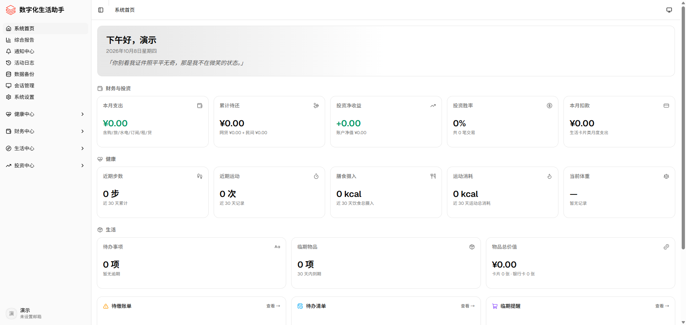

<p align="center">
  
</p>

<h1 align="center">LifeOS V2.0</h1>

<p align="center">
  个人生活管理系统 —— 一站式管理健康、财务、生活方式、投资与日常提醒
</p>

<p align="center">
  <strong>版本：</strong> v2.0 ｜ <strong>状态：</strong> 活跃开发中
</p>

---

LifeOS 将个人生活的核心维度整合到一个统一平台：记录健康数据、掌控财务状况、整理生活方式、追踪投资表现，并通过通知中心自动推送到期提醒。所有数据存储在你自有的数据库中，可随时备份，隐私安全可控。

---

## 功能特性

### 健康中心

| 功能 | 说明 |
|---|---|
| 健康总览 | 聚合展示各项健康数据的看板，异常项高亮 |
| 睡眠体征 | 血压、心率、血氧、体温与睡眠时长追踪；支持小米手环心率自动采集 |
| 健身运动 | 运动、饮食与身体指标三合一（体重 / BMI / 体脂，支持蓝牙体脂秤称重后自动写入） |
| 步数统计 | 按日 / 按月双视图，17 个时间段完整性检测，漏录自动弹窗提醒并可连续补录 |
| 体检指标 | 体检记录、指标面板与项目化追踪 |
| 用药跟踪 | 早 / 午 / 晚分餐次服药管理，购药记录与药品库存按粒实时扣减，低库存每日提醒 |
| 健康报告 | 近 7 / 30 / 90 天或自定义区间，自动汇总生成并可导出 PDF |

### 财务管理

| 功能 | 说明 |
|---|---|
| 财务总览 | 收支与债务概览、月度统计与趋势 |
| 购物记录 | 多平台购物账本，金额精确到分 |
| 旅行开支 | 行程账本式记录，按行程生成旅行报告 |
| 账单管理 | 房租水电（住房、付款期次、押金、水电燃气、自动折算单日成本）、服务订阅、网贷借还三类账单统一管理；还款记录支持优惠抵扣，平台级容时（宽限期）与违约金日费率估算（仅预警不改账务） |
| 财务规划 | 未来资金安排与目标规划 |
| 债务管理 | 债务备忘录与还款明细，支持优惠金额与实付计算 |
| 财务报告 | 周期化收支分析，可导出 PDF |

### 生活方式

| 功能 | 说明 |
|---|---|
| 生活总览 | 物品、卡片与到期事项一站式汇总 |
| 物品追踪 | 个人物品登记与整理，保质期到期提醒 |
| 卡片管理 | 银行卡、电话卡维护；银行卡有效期阶梯提醒（≤90 天每月、最后 15 天每天）、还款日与手机卡月租提醒 |
| 生活报告 | 周期化生活数据汇总，可导出 PDF |

### 投资管理

| 功能 | 说明 |
|---|---|
| 投资总览 | 账户净值、入金出金与收益总览 |
| 外汇交易 | 资金流水（入金 / 出金 / 体验金）、持仓清单与交易日历，净值实时计算 |
| 投资报告 | 周期化收益分析，可导出 PDF |

### 通知中心

| 功能 | 说明 |
|---|---|
| 消息列表 | 站内通知收件箱，正文保留多行排版与来源标记 |
| 提醒开关 | 按功能模块独立开关（财务 5 类 / 生活 4 类 / 健康 2 类） |
| 通知模板 | 自定义消息模板，支持占位符与多行结构化排版 |
| 渠道管理 | 多渠道配置，敏感字段加密存储；邮件渠道独立配置 |
| 定时提醒 | 每日 08:30 自动扫描：服务订阅、水电燃气、房租、网贷 / 房贷（含容时提示与违约金估算）、债务、物品保质期、手机卡月租、银行卡还款日、银行卡有效期、体检到期、药品低库存；网贷逾期与容时最后一天支持按小时提醒 |
| 发送日志 | 完整记录每次通知投递情况 |

### 系统功能

| 功能 | 说明 |
|---|---|
| 用户认证 | 注册 / 登录，JWT 双令牌（access 24 小时 + refresh 365 天；每次刷新滑动续期并轮换令牌，持续使用不掉线），登录失败锁定保护 |
| 安全审计 | 登录记录、失败原因与来源 IP 追踪（仅管理员） |
| 会话管理 | 在线设备查看与强制下线，会话删除后该令牌立即失效（仅管理员） |
| 用户中心 | 个人资料与账户设置 |
| 系统设置 | 自定义系统 LOGO、标题及登录 / 注册页文案（仅管理员） |
| 数据备份 | 数据全量导出（JSON / SQL）与导入、定时备份计划与备份渠道管理（仅管理员） |
| 活动日志 | 全站操作审计，变更可追溯（仅管理员） |

### 智能设备接入（可选）

| 设备 | 说明 |
|---|---|
| 小米手环 | 后端进程内蓝牙扫描，按日聚合心率（滑动窗口去抖），自动写入「睡眠体征」心率字段，不覆盖手工填写的其他体征 |
| 蓝牙体脂秤 | 识别私有服务 UUID，称重稳定后写入当日体重 / BMI 与体成分（同一天后一次称重覆盖前一次），并记录活动日志 |

> 两项采集均默认关闭，通过 `.env` 的 `ENABLE_WATCH_COLLECTOR` / `ENABLE_SCALE_COLLECTOR` 开启；无蓝牙适配器的服务器请保持关闭，不影响其他功能。

---

## 效果预览

### 系统首页


> 更多模块截图将持续更新。

---

## 技术栈

| 端 | 技术 |
|---|---|
| 后端 | Python 3 · FastAPI · SQLAlchemy · MySQL 8 |
| 前端 | React 19 · TypeScript · Vite · Tailwind CSS · shadcn/ui（Radix UI） |
| 认证 | JWT 双令牌（access + refresh，滑动续期 + 令牌轮换） |
| 图表 | Recharts |
| 主题 | next-themes（浅色 / 深色 / 跟随系统） |
| 报告导出 | PDF（ReportLab） |
| 任务调度 | APScheduler（每日提醒扫描、会话清理） |
| 设备接入 | bleak（BLE 蓝牙扫描，可选） |

---

## 项目结构

```
LifeOS V2.0/
├── backend/             # 后端服务（FastAPI，端口 9515）
│   ├── app/             # 应用代码（模型 / 接口 / 服务 / 定时任务）
│   └── backups/         # 数据库备份归档（仅本地，不入库）
├── frontend/            # 前端应用（Vite，端口 9015）
│   └── src/             # 页面、组件与配置源码
├── vercel-demo/         # Vercel 在线演示版（完整前端 + 内置模拟数据，无需后端）
├── images/              # 文档配图
├── 说明文档.md           # 项目管理载体（规划 / 实施方案 / 进度记录）
└── README.md
```

---

## 本地快速开始

### 环境要求

| 依赖 | 版本 |
|---|---|
| Python | 3.10+ |
| Node.js | 18+ |
| MySQL | 8.0+ |

### 1. 启动后端（端口 9515）

```bash
cd backend

# 安装依赖
pip install -r requirements.txt

# 配置环境变量：复制 .env.example 为 .env，按需修改数据库连接与密钥
cp .env.example .env

# 启动服务
python -m uvicorn app.main:app --host 0.0.0.0 --port 9515 --reload
```

> 首次启动会自动创建数据库表，并初始化通知渠道等基础数据。**注册的第一个账号会自动成为管理员**，拥有「系统设置」的修改权限。
>
> `.env` 中的手环 / 体重秤采集默认关闭（`ENABLE_WATCH_COLLECTOR=false`、`ENABLE_SCALE_COLLECTOR=false`）；需要自动采集时再开启，并确保机器蓝牙可用。

### 2. 启动前端（端口 9015）

```bash
cd frontend
npm install
npm run dev
```

浏览器访问 `http://localhost:9015`，注册账号后即可开始使用。

> 前端已配置 `/api` 代理到后端；局域网设备可通过 `http://<局域网IP>:9015` 访问。

### 3. 在线演示版（vercel-demo，端口 4173）

`vercel-demo/` 是前端的独立副本，内置模拟数据层（`src/demo/snapshot.json` + `src/demo/mock-api.ts`），通过拦截 `/api/v1/*` 请求返回演示数据，**无需后端即可运行全部页面**。

```bash
cd vercel-demo
npm install
npm run dev        # 本地调试
npm run build      # 构建产物输出到 dist/
npm run preview    # 预览构建产物
```

- 演示账号：`demo`　密码：`demo123456`（注册入口已关闭）
- 新增 / 编辑 / 删除等写操作仅保存在浏览器 `localStorage`，刷新后仍保留；清除该站点的本地存储即可恢复初始演示数据
- 统计类数值来自内置快照，写操作后不会自动重算

### 4. 接口文档（可选）

后端启动后，可通过以下地址查看与调试接口：

- Swagger UI：`http://localhost:9515/docs`
- ReDoc：`http://localhost:9515/redoc`

---

## Vercel 在线演示部署

演示版是纯静态站点，无需数据库与后端服务，可直接部署到 Vercel：

1. 在 Vercel 控制台 **Add New → Project**，导入本仓库（`ZeroOneCN/LifeOS2`）。
2. **Root Directory** 选择 `vercel-demo`。
3. **Framework Preset** 选择 `Vite`；Build Command 为 `npm run build`，Output Directory 为 `dist`（`vercel-demo/vercel.json` 已内置该配置与 SPA 路由重写）。
4. 无需配置任何环境变量，点击 Deploy 即可。
5. 部署完成后访问生成的域名，使用演示账号 `demo` / `demo123456` 登录体验。

> 后续若前端有更新，同步复制到 `vercel-demo/` 后重新提交即可；演示数据由 `src/demo/snapshot.json` 提供，可按需替换。

---

## 服务器部署方案

以下以 **Ubuntu 22.04 / Debian 12** 为例，介绍经典的单机部署架构：

```
用户浏览器
    │  HTTPS (443)
    ▼
Nginx ──┬── / 前端静态资源（frontend/dist 构建产物）
        │
        └── /api 反向代理
                 │  HTTP (9515)
                 ▼
            Uvicorn 后端（systemd 守护）
                 │
                 ▼
              MySQL（3306，仅本机监听）
```

### 服务器要求

- 系统：Ubuntu 22.04 / Debian 12（64 位）
- 配置：2 核 4G 起步（含 MySQL）
- 域名：可选（有域名可配置 HTTPS）

### 1. 基础环境

```bash
# 安装系统依赖
apt update
apt install -y python3 python3-venv python3-pip mysql-server nginx git

# 安装 Node.js
curl -fsSL https://deb.nodesource.com/setup_20.x | bash -
apt install -y nodejs
```

### 2. 获取代码

```bash
git clone https://github.com/ZeroOneCN/LifeOS2.git /opt/lifeos
cd /opt/lifeos
```

### 3. 初始化数据库

```bash
systemctl enable --now mysql
mysql -uroot -p
```

```sql
CREATE DATABASE lifeos CHARACTER SET utf8mb4 COLLATE utf8mb4_unicode_ci;
CREATE USER 'lifeos'@'localhost' IDENTIFIED BY '你的强密码';
GRANT ALL PRIVILEGES ON lifeos.* TO 'lifeos'@'localhost';
FLUSH PRIVILEGES;
```

### 4. 部署后端

```bash
cd /opt/lifeos/backend

python3 -m venv .venv
source .venv/bin/activate
pip install -r requirements.txt

cp .env.example .env
vim .env
```

`.env` 关键配置（生产环境务必修改）：

| 配置项 | 说明 |
|---|---|
| `DATABASE_URL` | 改为上一步创建的数据库账号连接串 |
| `JWT_SECRET_KEY` | 改为随机长字符串，禁止使用默认值 |
| `CORS_ALLOW_ALL` | 设为 `False`，并配置 `CORS_ORIGINS` 白名单 |

创建 systemd 服务：

```ini
# /etc/systemd/system/lifeos.service
[Unit]
Description=LifeOS Backend
After=network.target mysql.service

[Service]
WorkingDirectory=/opt/lifeos/backend
ExecStart=/opt/lifeos/backend/.venv/bin/uvicorn app.main:app --host 127.0.0.1 --port 9515
Restart=always
RestartSec=3
User=www-data

[Install]
WantedBy=multi-user.target
```

```bash
systemctl daemon-reload
systemctl enable --now lifeos
```

### 5. 构建并部署前端

```bash
cd /opt/lifeos/frontend
npm ci
npm run build
```

### 6. 配置 Nginx

```nginx
# /etc/nginx/sites-available/lifeos
server {
    listen 80;
    server_name your-domain.com;

    root /opt/lifeos/frontend/dist;
    index index.html;

    location / {
        try_files $uri $uri/ /index.html;
    }

    location /api/ {
        proxy_pass http://127.0.0.1:9515;
        proxy_set_header Host $host;
        proxy_set_header X-Real-IP $remote_addr;
        proxy_set_header X-Forwarded-For $proxy_add_x_forwarded_for;
        proxy_set_header X-Forwarded-Proto $scheme;
    }
}
```

```bash
ln -s /etc/nginx/sites-available/lifeos /etc/nginx/sites-enabled/
rm -f /etc/nginx/sites-enabled/default
nginx -t && systemctl reload nginx
```

### 7. 启用 HTTPS（可选）

```bash
apt install -y certbot python3-certbot-nginx
certbot --nginx -d your-domain.com
```

### 8. 数据库自动备份

```bash
crontab -e
# 每日凌晨 3 点备份
0 3 * * * mysqldump -ulifeos -p'你的强密码' lifeos | gzip > /var/backups/lifeos_$(date +\%Y\%m\%d).sql.gz && find /var/backups -name "lifeos_*.sql.gz" -mtime +30 -delete
```

### 9. 部署验证清单

- [ ] 后端服务运行中：`systemctl status lifeos`，访问 `http://<IP>:9515/docs` 可打开接口文档
- [ ] 前端可访问：浏览器打开 `http://<IP>` 能正常登录使用
- [ ] 注册 / 登录、数据增删改查、报告导出均正常
- [ ] 通知提醒在设定时间正常触发（检查发送日志）
- [ ] HTTPS 证书有效（如已配置）
- [ ] 管理员进入「系统设置」，保存 LOGO 与标题后全站同步生效

> **内网 / 局域网部署**：若仅个人或家庭使用，可不启用 Nginx，直接以 `uvicorn ... --host 0.0.0.0 --port 9515` 运行后端、`npm run dev` 运行前端，并将 `CORS_ALLOW_ALL` 保持 `True` 即可。

---

## 注意事项

### 安全

- **生产环境必须修改 `JWT_SECRET_KEY`**，使用默认值存在严重安全隐患
- 生产环境建议将 `CORS_ALLOW_ALL` 设为 `False`，仅放行实际访问来源
- 数据库账号使用强密码，禁止使用 root 直连业务库
- 通知渠道的敏感凭据（如邮件密钥）经加密存储，请妥善保管 `NOTIFICATION_ENC_KEY`，丢失后将无法解密已存凭据
- `.env` 等环境变量文件一律不提交到版本库
- 品牌配置（LOGO / 标题）属全站公开读取项，请勿在其中填写敏感信息

### 数据

- **任何数据库结构变更、数据导入操作前，必须先创建备份**
- 数据库备份归档保留在 `backend/backups/`，不会同步到远程仓库
- 报告生成周期统一支持近 7 / 30 / 90 天与自定义起止日期
- 备份导出 / 导入会包含品牌配置（LOGO 以 base64 存于数据库）

### 运维

- 每日提醒扫描时间默认为 `08:30`，可通过 `.env` 的 `NOTIFY_SCAN_TIME` 调整
- 各提醒功能默认关闭，需在「通知中心 → 提醒开关」按需逐项开启
- 过期会话每日 `03:00` 自动清理；登录有效期见「系统功能」（access 24 小时 + refresh 365 天滑动续期）
- 服务器时区务必正确配置（提醒任务基于服务器本地时间）
- 首次启动会自动建表；项目未接入 Alembic 迁移工具，**新增表**会随启动自动创建，已有表的字段变更需手工执行 SQL
- 手环 / 体重秤采集依赖后端所在机器的蓝牙适配器与 `bleak`（Windows 需 WinRT），无蓝牙时采集器自动指数退避重试，不影响其他功能
- 升级代码前先 `git pull` 并阅读变更记录

### 使用

- 所有删除操作均需二次确认，误删不可恢复
- 数据保存后页面实时刷新，无需手动刷新浏览器
- 步数等数据录入支持连续录入（Enter 保存并跳转下一时段）
- 系统 LOGO、标题与登录 / 注册页文案统一在「系统设置」维护（仅管理员）
- 界面为响应式布局，手机 / 平板浏览器可直接访问；窄屏下卡片头部的操作按钮支持横向滑动，不会被裁切

---

## 数据与隐私

- 所有业务数据存储在你自有的 MySQL 数据库中，服务器数据只属于你
- 数据库备份文件保留在本地归档目录，不纳入版本库
- 密钥、环境变量、本地临时文件均通过 `.gitignore` 排除
- 通知渠道的敏感凭据经加密后存储
- 本项目不收集、不上传任何用户行为数据

---

## 开发约定

- 代码变更遵循「先拉取、后修改、完成后提交推送」的流程，每步完成即提交
- 开发前先阅读根目录 `说明文档.md` 确认当前进度与要求，计划或进度变更时即时更新该文档
- 提交信息使用中文，描述清晰准确
- 前端遵循 shadcn/ui 组件规范，样式统一使用主题变量
- 所有 CRUD 操作需实现实时刷新，并展示主题样式 toast 提示
- 所有函数需添加函数级注释（功能描述、参数说明、返回值类型及用途）

---

## 许可证与声明

本项目为个人生活管理工具，代码与数据均归项目所有者所有。使用过程中产生的任何数据安全风险由使用者自行承担。
