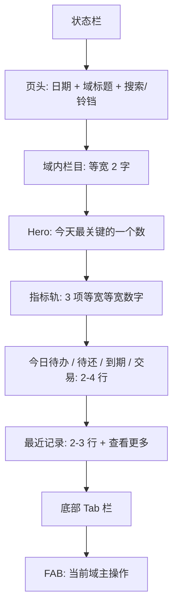

# LifeOS APP 2.0 改版方案

> 版本：v0.1（方案稿）  
> 日期：2026-11-25  
> 范围：仅移动端（`mobile/`），不含 Web 端与后端  
> 配套设计稿：[ui.html](./ui.html)

---

## 1. 结论先行

APP 2.0 不做「换皮」，而是把移动端从 **「功能目录 + 卡片矩阵」** 重构为 **「生活仪表盘」**。

三条主线：

1. **一级导航保持不变**：健康 / 财务 / 生活 / 投资 / 设置 五个 Tab，降低迁移成本，也不牺牲投资与设置的可达性。
2. **每个域的首屏从「入口列表」变成「今天的生活」**：先回答「现在怎么样、今天要做什么、最近发生了什么」，功能入口收敛为一行「域内栏目」+ 顶部全局搜索 + 底部「更多」。
3. **视觉改成 Apple 设计语言**：iOS 系统色（System Blue 为唯一强调色）、SF 字体层级、分组列表卡片、半透明 Tab 栏；深浅色同构，跟随系统可切换。

一句话：**2.0 的首屏应该是内容，不是菜单。**

本版已确认：五 Tab 不变；下拉刷新为唯一刷新方式；通知中心不提升为一级入口；快捷面板覆盖记账 / 购物 / 交易；配色使用 Apple 系统色，不再使用冷青。

---

## 2. 现状诊断（基于代码，不是主观感受）

| 现象 | 代码证据 | 用户影响 |
|---|---|---|
| 首屏是入口矩阵，不是内容 | [health_page.dart](../../mobile/lib/features/health/health_page.dart) 依次渲染「常用」2×2 `PrimaryFeatureCard`、「全部功能」2 列 `FeatureTile`、「本周概览」 | 打开健康中心先看到 8 个方块，今天该吃什么药反而要再点一层 |
| 卡片套卡片 | `RootPageScaffold` 内叠 `SectionCard`，`SectionCard` 内再放 `Card`（`PrimaryFeatureCard` / `FeatureTile`），三层圆角与描边 | 视觉噪声大，信息层级被不断重置 |
| 摘要被迫单行缩放 | `PrimaryFeatureCard` 用 `FittedBox(scaleDown)` 把「待还 ¥…」压成一行 | 1.3x 字号下摘要会缩小，反而更难读 |
| 每页重复同一套顶栏 | `RootPageScaffold` 固定「标题 + 刷新 + 铃铛」，域与域之间没有辨识度 | 五个 Tab 长得一样，切换后缺少「我在哪」的感知 |
| 设置页也是纵向卡片堆 | [settings_page.dart](../../mobile/lib/features/settings/settings_page.dart) 账户卡 + 状态卡 + 账户 + 设备 + 外观 + 字体 + 更新 | 设置本身信息密度过高，找不到重点 |
| 录入优先靠 FAB → 整页表单 | 各 `*_form_page.dart` 均为独立整页表单 | 高频小记录（一笔支出、一次称重）路径过长 |

**核心矛盾：页面在「展示功能有多少」，而不是「展示生活怎么样」。**

---

## 3. 2.0 设计主张

### 3.1 六条原则

1. **内容优先（Content first）**：首屏 70% 面积给真实数据与待办，功能入口不超过一行。
2. **一屏一主题（One screen, one question）**：每个域首屏只回答一个问题——健康「今天状态如何」、财务「这个月钱怎么样」、生活「什么快到期」、投资「账户现在如何」。
3. **去卡片化（De-card）**：用底色分层 + 发丝线替代卡片描边；同一屏最多一个「容器」，不再卡片套卡片。
4. **数字优先（Numbers first）**：关键金额、步数、净值用大号等宽数字 + `tabular-nums`，一眼可读、上下对齐。
5. **入口可发现但不打扰（Findable, not loud）**：域内栏目常驻一行等宽 2 字文字轨道，全局搜索覆盖全部功能与记录；「更多」承载长尾。
6. **两套主题同构（Dual theme, one structure）**：深色为主视觉，浅色为同构映射，不出现「深色能看、浅色塌掉」。

### 3.2 明确不做

- 不改后端接口与数据口径，2.0 是纯前端信息架构与视觉重构。
- 不引入图表库、动画库、图标包，继续使用 Flutter 内置能力与现有 SVG/Icon。
- 不新增业务功能；所有现有功能必须在 2.0 中有明确落点（见 §4.3 覆盖表）。
- 不做玻璃拟态、光斑、渐变球等装饰性效果。
- 不使用冷青/冰蓝作为强调色，统一改为 iOS 系统色。

---

## 4. 信息架构

### 4.1 一级结构：五个 Tab 不变

```
健康 ｜ 财务 ｜ 生活 ｜ 投资 ｜ 设置
```

不在 2.0 引入「今日」第六个 Tab：五个 Tab 在 375dp 下已是可用宽度上限；跨域待办改由**顶部全局搜索/指令入口**与**各域待办区**共同承担，避免导航膨胀。通知中心维持顶栏铃铛 + 设置内「通知中心」，不提升为一级入口。

### 4.2 二级结构：域内栏目（常驻一行）

每个域首屏标题下方固定一行横滑栏目，它是「功能的唯一常驻入口」，替代原「常用 + 全部功能」两段网格。

| Tab | 域内栏目（从左到右） |
|---|---|
| 健康 | 概览 · 睡眠 · 用药 · 运动 · 饮食 · 体重 · 步数 · 体检 · 报告 |
| 财务 | 概览 · 账单 · 债务 · 购物 · 旅行 · 规划 · 流水 · 报告 |
| 生活 | 概览 · 物品 · 卡片 · 报告 |
| 投资 | 概览 · 外汇 · 分析 · 日历 · 报告 |
| 设置 | 账户 · 连接 · 设备 · 外观 · 通知 · 更新 |

> **所有域内栏目统一 2 个汉字，不多不少**（如「睡眠体征」在栏目中写作「睡眠」，页面标题仍可用全称）。一屏严格 6 等分：每项占 1/6 宽、字号 14，只露出 6 个完整栏目，不出现半个字；选中态为居中的 2px System Blue 短下划线。超过 6 项时横滑并吸附，右侧用 6% 渐隐提示「还有更多」；不足 6 项时等分铺满。

### 4.3 全功能覆盖对照表（确保零遗漏）

| 现有路由 | 2.0 落点 | 首屏是否直达 |
|---|---|---|
| `/health` | 健康 · 概览 | 是（默认） |
| `/health/vitals-sleep` | 健康 · 睡眠体征 | 栏目直达 |
| `/health/medication` | 健康 · 用药 | 栏目直达 + 今日待办卡 |
| `/health/fitness` | 健康 · 运动 | 栏目直达 |
| `/health/diet` | 健康 · 饮食 | 栏目直达 |
| `/health/body`（含 `ble`） | 健康 · 体重 | 栏目直达 + 快捷称重 |
| `/health/steps` | 健康 · 步数 | 栏目直达 + Hero 步数 |
| `/health/checkup` | 健康 · 体检 | 栏目直达 |
| `/health/reports` | 健康 · 报告 | 栏目直达 + 「更多」 |
| `/finance` | 财务 · 概览 | 是（默认） |
| `/finance/bills` | 财务 · 账单 | 栏目直达 + 待还清单 |
| `/finance/debts` | 财务 · 债务 | 栏目直达 |
| `/finance/shopping` | 财务 · 购物 | 栏目直达 |
| `/finance/travel` | 财务 · 旅行 | 栏目直达 |
| `/finance/planning` | 财务 · 规划 | 栏目直达 |
| `/finance/transactions` | 财务 · 流水 | 栏目直达 |
| `/finance/reports` | 财务 · 报告 | 栏目直达 |
| `/life` | 生活 · 概览 | 是（默认） |
| `/life/items` | 生活 · 物品 | 栏目直达 + 到期时间线 |
| `/life/cards` | 生活 · 卡片 | 栏目直达 + 到期时间线 |
| `/life/reports` | 生活 · 报告 | 栏目直达 |
| `/invest` | 投资 · 概览 | 是（默认） |
| `/invest/forex` | 投资 · 外汇 | 栏目直达 + 明细入口 |
| `/invest/forex/analysis` | 投资 · 分析 | 栏目直达 |
| `/invest/forex/calendar` | 投资 · 日历 | 栏目直达 |
| `/invest/reports` | 投资 · 报告 | 栏目直达 |
| `/settings/account` | 设置 · 账户 | 是 |
| `/settings/server` | 设置 · 服务器 | 是 |
| `/settings/devices` | 设置 · 设备 | 是 |
| `/settings/update` | 设置 · 更新 | 是 |
| `/settings/about` | 设置 · 关于 | 是 |
| `/notifications` | 全局铃铛（所有页顶栏） | 是 |

### 4.4 全局搜索与「更多」

- **顶部搜索**：点击展开全屏搜索层，输入即搜「功能名 / 记录标题 / 金额 / 日期」，结果按「功能 / 记录 / 快捷操作」分组。解决入口收敛后的可发现性问题。
- **域内「更多」**：每个域底部保留一行 `更多 · 报告 / 归档` 文本入口，不做第二组网格。
- **长尾功能**：全部功能可通过搜索直达，不设独立「功能大全」页，避免再次长成目录。

---

## 5. 页面骨架与逐域设计

### 5.1 统一骨架



结构约束：

- 页头不再使用 `AppBar` 的「标题 + 刷新 + 铃铛」三件套；改为**大标题 + 日期副标题 + 搜索 + 铃铛**，刷新改为下拉刷新，减少顶栏按钮。
- 一屏最多出现 **1 个 Hero + 1 条指标轨 + 2 个列表区**，超出的内容进入各栏目页。
- 列表行统一「左时间/标签、中标题+副信息、右状态/数值」，行高 ≥ 56，1.3x 字号不折行。

### 5.2 健康 · 概览

| 区块 | 内容 |
|---|---|
| Hero | 今日步数 `6,842`，副行「目标 8,000 · 还差 1,158」，下方 1px 进度条 |
| 指标轨 | 睡眠 `7h12m`、体重 `68.4kg`、静息心率 `62` |
| 今日待办 | 早 08:00 维生素 D（已服）、晚 20:30 阿托伐他汀（待服）；右侧状态胶囊 |
| 最近记录 | 血压 `118/76`、睡眠 `7h12m`、体重 `68.4kg`，按时间倒序 |
| 快捷 | FAB「+」→ 快速记录（步数/体重/服药/体征） |

### 5.3 财务 · 概览

| 区块 | 内容 |
|---|---|
| Hero | 本月结余 `+¥3,286.40`，副行「收入 ¥9,426.60 · 支出 ¥6,140.20」 |
| 指标轨 | 待还 `¥4,820.00`、待还笔数 `3`、贷款余额 `¥12,000` |
| 待还清单 | 房租 `11-28 ¥2,400`（剩 3 天）、水电燃气 `11-30 ¥320`、花呗 `12-02 ¥1,120` |
| 最近流水 | 2 笔，带分类与金额（支出用红、收入用绿，System Blue 不参与涨跌语义） |
| 快捷 | FAB「+」→ 快速记账（金额键盘 + 分类） |

> 文案遵循既有偏好：用「待还 / 贷款」而非「负债」；金额统一等宽右对齐。

### 5.4 生活 · 概览

| 区块 | 内容 |
|---|---|
| Hero | 即将到期 `3 项`，副行「最近 6 天 · 护肤品 / 银行卡」 |
| 指标轨 | 物品 `42`、卡片 `8`、本月新增 `3` |
| 到期时间线 | 护肤品 `12-01`（剩 6 天）、银行卡有效期 `12-14`（剩 19 天）、话费余额 `¥18.40`（偏低） |
| 快捷 | FAB「+」→ 新增物品 / 新增卡片 |

### 5.5 投资 · 概览

| 区块 | 内容 |
|---|---|
| Hero | 账户净值 `$12,480.36`，副行「累计净盈亏 +$1,284.20 · +11.5%」 |
| 曲线 | 30/90/365 区间轻量切换，仅一条绿色折线（下跌转红）+ 极淡面积，不加网格与坐标轴 |
| 指标轨 | 累计净盈亏、胜率 `62.4%`、品种 `4` |
| 最近交易 | EURUSD `+$184.20`、XAUUSD `-$62.40`，带方向色 |
| 快捷 | FAB「+」→ 新增交易 / 资金流水 |

### 5.6 设置 · 概览

| 区块 | 内容 |
|---|---|
| 账户头 | 头像 + 昵称 + 账号 + 连接状态（在线/离线保留登录） |
| 分组 1 | 账户设置、登录设备 |
| 分组 2 | 通知中心、服务器地址 |
| 分组 3 | 外观（跟随系统 / 浅色 / 深色）、字体大小（小 / 标准 / 大 / 特大） |
| 分组 4 | 检查更新、关于 |
| 底部 | 版本号 + 构建号，右对齐小字 |

> 分组之间用 24px 间距 + 小标题，不再使用带描边的 `SectionCard`。

### 5.7 二级页与表单

- 详情页：顶部返回 + 标题 + 「编辑」文字按钮；内容为「头部数值 + 明细行」，底部固定「保存 / 删除」双按钮（左保存右删除，等宽等高）。
- 表单页：单列分组字段，字段说明统一用问号图标 + 悬停/长按气泡，不单独占行；底部固定主按钮。
- 高频轻录入（记账 / 购物 / 交易 / 称重 / 服药）改为**底部快捷面板**，不跳整页；复杂编辑仍进整页表单。快捷面板首批覆盖记账、购物、交易三种模式。
- 刷新统一走**下拉刷新**，根页顶栏不再放刷新图标。

---

## 6. 视觉系统

### 6.1 色彩令牌（Apple 系统色）

| 令牌 | 浅色 | 深色 | 用途 |
|---|---|---|---|
| `--bg` | `#F2F2F7` | `#000000` | 分组背景 |
| `--surface` | `#FFFFFF` | `#1C1C1E` | 卡片、快捷面板 |
| `--surface-2` | `#E5E5EA` | `#2C2C2E` | 次级块 |
| `--line` | `rgba(60,60,67,.29)` | `rgba(84,84,88,.65)` | 分组分隔线 |
| `--text` | `#000000` | `#FFFFFF` | 主文字 |
| `--text-2` | `rgba(60,60,67,.6)` | `rgba(235,235,245,.6)` | 次要文字 |
| `--text-3` | `rgba(60,60,67,.3)` | `rgba(235,235,245,.3)` | 辅助/占位 |
| `--accent` | `#007AFF` | `#0A84FF` | System Blue，唯一强调色 |
| `--green` | `#34C759` | `#30D158` | 上涨/收入/正常 |
| `--red` | `#FF3B30` | `#FF453A` | 下跌/支出/危险 |
| `--orange` | `#FF9500` | `#FF9F0A` | 临期/待处理 |

规则：

- **不再使用冷青/冰蓝**；强调色统一为 iOS System Blue。
- 绿/红只表达涨跌与收支，不参与导航与主操作。
- 橙色只用于临期/待处理，以小面积文字或徽标呈现。
- 深色使用纯黑底 + `#1C1C1E` 卡片，不改变层级结构。

### 6.2 字体与数字

| 层级 | 字号 / 行高 | 字重 | 说明 |
|---|---|---|---|
| Hero 数值 | 48 / 51 | 700 | SF Pro Display，`tabular-nums`，`letter-spacing:-1.4px` |
| 大标题 | 34 / 38 | 700 | Large Title，`letter-spacing:-.6px` |
| 行标题 | 16 / 21 | 400 | Body |
| 区块标题 | 13 / 16 | 600 | `--text-2` |
| 副信息 | 13 / 18 | 400 | `--text-2` |
| 徽标/标签 | 12 / 14 | 600 | 圆角 6 |

所有金额、步数、净值、百分比使用 `font-variant-numeric: tabular-nums`，保证跨行对齐。

### 6.3 间距、圆角、描边

- 基础栅格 4pt；页面左右边距 20；分组卡片圆角 14；快捷面板顶部圆角 20。
- 控制圆角：按钮/输入/分段控件 `10–12px`，徽标 `6px`。
- 分隔线：`0.5px`，左缩进 16；不使用重描边。
- 卡片：白底分组卡，不套卡片；仅快捷面板允许一层柔和阴影。
- 图标：24 线性图标，描边 1.7，圆头圆角，统一 `currentColor`。

### 6.4 动效

| 场景 | 规则 |
|---|---|
| Tab 切换 | 150ms 淡入 + 4px 上移，不做缩放 |
| 列表加载 | 骨架屏 1.2s 循环，避免整页 spinner |
| 下拉刷新 | System Blue 细线进度，完成后 200ms 收起 |
| 快捷面板 | 240ms 上滑，背景遮罩 160ms 淡入 |
| 数字变化 | 200ms 数值滚动，不做弹跳 |

---

## 7. 核心组件清单

| 组件 | 说明 | 替代 |
|---|---|---|
| `DomainHeader` | 日期 + 大标题 + 搜索 + 铃铛 | 原 `AppBar` 三件套 |
| `DomainTabs` | 严格 6 等分、统一 2 字，System Blue 短下划线，右侧渐隐 | 原「常用 + 全部功能」网格 |
| `HeroMetric` | 标签 + 大数字 + 副行 + 可选进度条 | 原 `PrimaryFeatureCard` 摘要 |
| `StatRail` | 3 项等宽指标，发丝线分隔 | 原 `Row(MetricPlaceholder)` |
| `TaskRow` | 时间 + 标题 + 状态胶囊 | 新增（今日待办） |
| `RecordRow` | 标签 + 标题 + 副信息 + 数值 | 新增（最近记录） |
| `DueRow` | 名称 + 到期日 + 剩余天数胶囊 | 新增（到期时间线） |
| `MoreLink` | 「查看更多」文本链接 | 原「全部功能」卡片 |
| `QuickSheet` | 底部快捷录入面板 | 原整页表单（高频场景） |
| `SearchOverlay` | 全屏搜索，分组结果 | 新增 |
| `Segmented` | 横向等宽分段（外观/字体/区间） | 复用现有 `AppTabSelector` 视觉 |
| `BottomBar` | 保存/删除等宽双按钮 | 复用现有 `DetailPageScaffold` 底栏 |

---

## 8. 关键交互规范

1. **加载**：首屏进入先显示骨架（Hero 数字占位 + 3 行行占位），不出现整页白屏或 spinner；切换 Tab 保留旧数据并降低透明度，避免布局抖动。
2. **空态**：Hero 显示 `—`，下方给一句可执行引导（如「还没有记录，点 + 添加第一条」），不放大插画。
3. **失败**：顶部一行 1px 警示条 + 「重试」文字，不遮挡已有内容；离线时沿用「保留旧数据 + 顶部提示」。
4. **返回**：Tab 根页拦截系统返回；二级页正常返回，未保存表单二次确认。
5. **搜索**：输入 1 个字符即出结果；无结果时给出「没有找到，试试功能名或金额」。
6. **快捷面板**：金额键盘常驻，保存后 200ms 关闭并回到原页面，Toast 只提示「已记录 ¥268.00」。
7. **可访问性**：所有图标按钮必须有中文 `tooltip` / `semanticLabel`；正文对比度不低于 4.5:1；点击区域 ≥ 44×44。
8. **字号档位**：小 / 标准 / 大 / 特大四档横向等宽，切换不重建页面、不重新请求数据。
9. **刷新**：下拉刷新是唯一刷新方式，顶栏不设刷新图标；刷新时保留旧数据，仅顶部显示细线进度。

---

## 9. 改造实施计划（建议分批，每批独立可回滚）

> 2.0 不一次性重写全部页面。先立骨架与令牌，再逐域替换，保证每批都能构建、能真机验收。

### 批次 0：设计定稿与令牌（本次交付）

- 产出本方案 + `ui.html`、`ui_apple.html` 多屏设计稿。
- 已确认：五 Tab / Apple 系统色 / 内容优先 / 下拉刷新为唯一刷新 / 快捷面板覆盖记账·购物·交易 / 通知不升一级。

### 批次 1：设计系统落地

- 新增 `theme/app_tokens.dart`（颜色、间距、圆角、字号），与现有 `AppColors` / `AppTheme` 并存，逐步替换。
- 新增 `shared/widgets/v2/`：`DomainHeader`、`DomainTabs`、`HeroMetric`、`StatRail`、`TaskRow`、`RecordRow`、`DueRow`、`MoreLink`。
- 只在新页面使用，不改旧页面，保证零回归。

### 批次 2：健康域重构

- 健康概览改为新骨架；栏目直达各子页；FAB 改为快捷记录面板。
- 真机验收 375 / 1.3x 两档，确认无截断、无横向滚动。

### 批次 3：财务域重构

- 财务概览 + 待还清单 + 快捷记账面板。
- 账单/债务详情页沿用新底栏规范。

### 批次 4：生活 + 投资域重构

- 生活到期时间线；投资净值 Hero + 轻量曲线。
- 涨跌色与 System Blue 强调色分离校验。

### 批次 5：设置域重构 + 全局搜索

- 设置改为分组列表；接入搜索层。
- 全量走查：所有路由可从栏目或搜索到达。

### 批次 6：清理与收口

- 删除不再使用的 `PrimaryFeatureCard` / `FeatureGrid` 旧网格（确认无引用后）。
- 更新 README 截图与功能说明。

---

## 10. 验收标准

### 10.1 结构

- [ ] 五个 Tab 与现有一致，切换保留各自导航栈。
- [ ] 每个域首屏只出现 1 个 Hero、1 条指标轨、≤2 个列表区。
- [ ] 首屏功能入口不超过一行栏目；所有旧功能可通过栏目或搜索到达（按 §4.3 逐项核对）。
- [ ] 所有域内栏目文案统一 2 个汉字，不多不少；一屏严格 6 等分，不出现半个字；选中态为居中的 System Blue 短下划线。
- [ ] 不再出现「卡片套卡片」；同屏容器描边不超过 1 层。

### 10.2 视觉

- [ ] 深色 / 浅色两套主题均通过对比度检查（正文 ≥ 4.5:1）。
- [ ] System Blue 只出现在导航、主操作、进度与可点文字；涨跌使用红绿。
- [ ] 所有数值等宽对齐，1.3x 字号下不折行、不缩小。
- [ ] 无玻璃拟态、无光斑、无渐变装饰。

### 10.3 交互

- [ ] 首屏加载有骨架，切换 Tab 不白屏、不抖动。
- [ ] 空态、失败、离线三态均有明确文案与可执行入口。
- [ ] 快捷面板保存后回到原页并给出 1 条 Toast。
- [ ] 所有图标按钮有中文 tooltip；点击区域 ≥ 44×44。

### 10.4 工程

- [ ] `flutter analyze` 0 error / 0 warning。
- [ ] 每批完成后可独立构建、可回滚。
- [ ] 未改动后端接口与数据口径。

---

## 11. 风险与待确认

| 风险 | 说明 | 应对 |
|---|---|---|
| 入口收敛后找不到功能 | 用户已习惯「全部功能」网格 | 域内栏目常驻 + 全局搜索 + 「更多」三重兜底；上线后观察搜索命中率 |
| 浅色/深色偏好差异 | 单一主题无法覆盖所有场景 | 默认跟随系统，两套主题同构；设置内可手动切换 |
| 投资曲线轻量化丢信息 | 原曲线支持点选与长按 | Hero 仅保留趋势；完整交互仍在「投资 · 分析」页 |
| 分域改造期间新旧风格并存 | 批次 2–5 期间可能出现两种页面 | 新组件只在新页面启用，旧页面不动；每批完成后统一走查 |
| 375dp 下栏目横滑可发现性 | 第 5 项可能被裁切 | 栏目右侧保留 20px 渐隐 + 半露下一项，明确「可横滑」 |

### 已确认决策

1. 保留五个 Tab，不新增「今日」。
2. 下拉刷新为唯一刷新方式，移除顶部刷新图标。
3. 通知中心不提升为一级入口，保留顶栏铃铛与设置内入口。
4. 快捷面板覆盖记账 / 购物 / 交易三种模式。
5. 配色改为 Apple 系统色，不再使用冷青。

### 待确认

1. 图标是否全套替换为 SF Symbols 风格（当前为通用线性图标）。
2. 深色是否作为默认外观，还是默认跟随系统。

---

## 12. 交付物

| 文件 | 说明 |
|---|---|
| `docs/APP2.0/APP2.0_改版方案.md` | 本方案 |
| `docs/APP2.0/ui.html` | v1 冷青方案，保留用于对比 |
| `docs/APP2.0/ui_apple.html` | v2 Apple 设计语言效果稿，9 屏，深/浅主题可切换，单文件无外链 |
