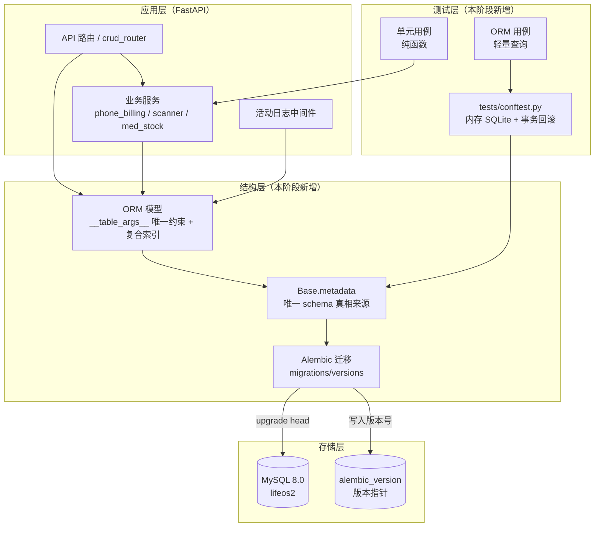
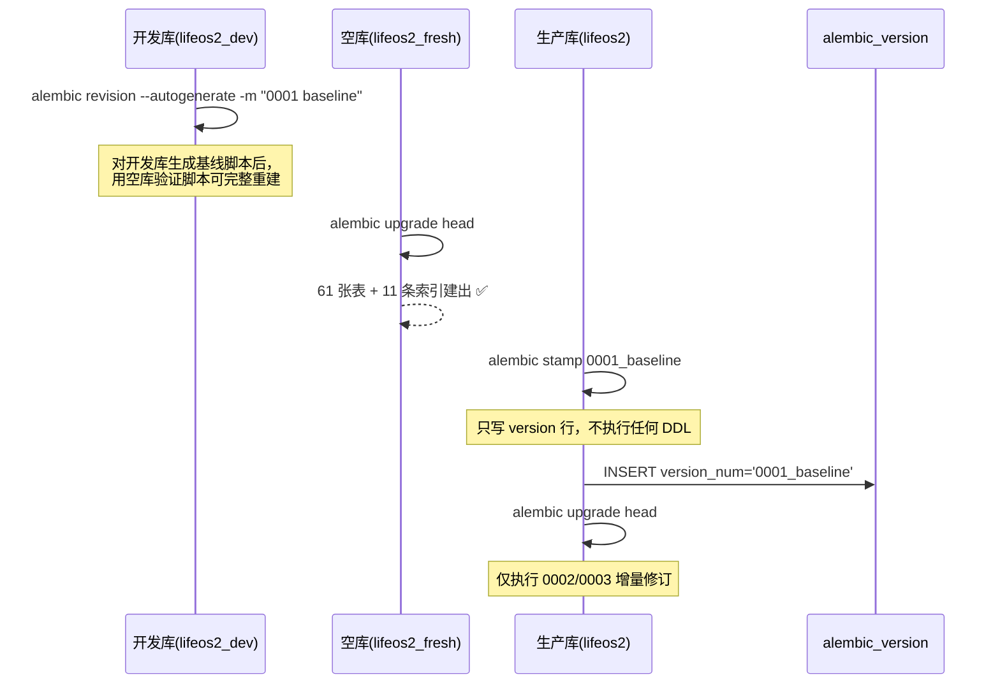
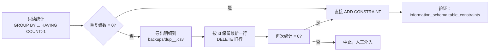
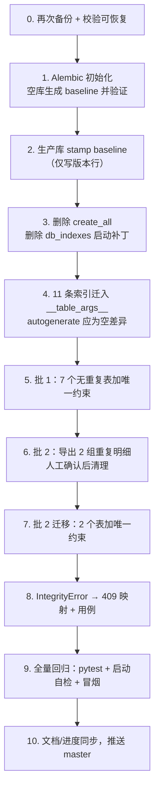

# DESIGN — 架构加固二期（结构地基）

> 阶段：6A 流程 · 阶段二（Architect）
> 上游文档：[ALIGNMENT_架构加固二期.md](file:///c:/Code/LifeOS2/docs/架构加固二期/ALIGNMENT_架构加固二期.md)
> 本文件状态：**设计草案，待审批后实施**

## 1. 总体架构



**核心原则**

1. `Base.metadata`（模型）是 schema 的唯一真相；Alembic 负责把差异应用到数据库。
2. 应用启动**不再**隐式改结构：`create_all` 与 `ensure_composite_indexes` 都退出 lifespan。
3. 索引/唯一约束写在模型 `__table_args__`，迁移由 autogenerate 产出，可审计、可回滚。
4. 测试不依赖 MySQL 服务（SQLite 内存库），MySQL 专属行为用标记用例单独覆盖。

## 2. Alembic 引入方案

### 2.1 目录与配置

```
backend/
├── alembic.ini                  # 新增：script_location=migrations, prepend_sys_path=.
├── migrations/                  # 新增（.gitignore 已预留 backend/migrations/backup/）
│   ├── env.py                   # 从 app.core.config.settings 读 DATABASE_URL
│   ├── script.py.mako
│   └── versions/
│       ├── 0001_baseline.py
│       ├── 0002_unique_constraints.py
│       └── 0003_drop_startup_index_patch.py
└── app/core/db_indexes.py       # 删除（索引迁入模型后不再需要）
```

`env.py` 关键点：

```python
from app.core.config import settings
from app.core.database import Base
import app.models  # noqa: F401  注册全部模型

config.set_main_option("sqlalchemy.url", settings.DATABASE_URL)
target_metadata = Base.metadata

def run_migrations_online():
    connectable = engine_from_config(..., poolclass=pool.NullPool)
    with connectable.connect() as connection:
        context.configure(
            connection=connection,
            target_metadata=target_metadata,
            compare_type=True,            # 捕获 Float/String 长度等类型漂移
            compare_server_default=True,  # 捕获默认值漂移
        )
```

### 2.2 baseline stamp 路径（决策 2 的推荐方案）



要点：

- **baseline 必须用空库验证**：脚本在空库能建出 61 表 + 11 索引，才算合格。
- 生产库只用 `stamp`，绝不执行 baseline 的 `upgrade`（会重复建表报错）。
- 若 `stamp` 后 `alembic upgrade head` 出现「表已存在」，说明 baseline 生成时把已存在对象写进去了，需重新生成。

### 2.3 11 条复合索引迁入模型

在各模型类中追加（示例 `HealthSteps`）：

```python
class HealthSteps(TimestampMixin, UserOwned, Base):
    __tablename__ = "health_steps"
    __table_args__ = (
        Index("ix_health_steps_user_date", "user_id", "record_date"),
    )
```

迁移清单（名称与字段保持不变，表名已修正为真实表名）：

| 模型 | 表 | 索引 | 字段 |
|------|----|------|------|
| HealthSteps | health_steps | ix_health_steps_user_date | user_id, record_date |
| HealthVitalsSleep | health_vitals_sleep | ix_vitals_user_date | user_id, record_date |
| HealthMedication | health_medication | ix_medication_user_date | user_id, record_date |
| HealthCheckup | health_checkup | ix_checkup_user_date | user_id, check_date |
| FinanceShoppingRecord | finance_shopping_records | ix_shopping_user_date | user_id, record_date |
| FinanceUtility | finance_utilities | ix_utility_user_month | user_id, bill_month |
| LifestyleCardBill | lifestyle_card_bills | ix_cardbill_user_month | user_id, bill_month |
| ActivityLog | activity_logs | ix_activity_user_created | user_id, created_at |
| Notification | notifications | ix_notif_user_date | user_id, notify_date |
| LoginAudit | login_audits | ix_loginaudit_account_created | account, created_at |
| LoginAudit | login_audits | ix_loginaudit_ip_created | ip_address, created_at |

因为现有库 11 条索引**已经全部存在**，迁入模型后 autogenerate 应为「无差异」；差异若出现，说明名称/字段写错，必须先修正再提交。

### 2.4 首个真实修订内容

`0002_unique_constraints.py`：只做 `ADD CONSTRAINT ... UNIQUE`（见第 3 节）。
`0003_drop_startup_index_patch.py`：空迁移（仅记录「索引已归位、补丁模块删除」），`downgrade` 为空操作——索引由模型/0001 负责，不需要在迁移里重复建。

## 3. 唯一约束方案

### 3.1 候选清单与命名规范

命名统一 `uq_<表简称>_<字段缩写>`，长度控制在 MySQL 64 字符内。

| # | 表 | 约束 | 名称 | 存量重复 | 分批 |
|---|----|------|------|----------|------|
| 1 | health_steps | (user_id, record_date, period) | uq_steps_user_date_period | 0 | 批 1 |
| 2 | health_vitals_sleep | (user_id, record_date) | uq_vitals_user_date | 0 | 批 1 |
| 3 | health_med_stock | (user_id, medicine_name) | uq_medstock_user_name | 0 | 批 1 |
| 4 | finance_utilities | (user_id, housing_id, bill_month, fee_type) | uq_util_user_house_month_type | 0 | 批 1 |
| 5 | finance_rent_terms | (user_id, housing_id, term_no) | uq_rentterm_user_house_no | 0 | 批 1 |
| 6 | lifestyle_card_bills | (user_id, phone_card_id, bill_month) | uq_cardbill_user_card_month | 0 | 批 1 |
| 7 | notifications | (user_id, source) | uq_notif_user_source | 0 | 批 1 |
| 8 | health_medication | (user_id, record_date, medicine_name) | uq_med_user_date_name | **1 组** | 批 2（需处置） |
| 9 | finance_loan_bills | (user_id, platform_id, bill_month) | uq_loanbill_user_platform_month | **1 组** | 批 2（需处置） |

### 3.2 存量重复处置策略（对应决策 1）

推荐流程（每一批都执行）：



- 导出文件放 `backend/backups/`（已被根 `.gitignore` 排除），不提交。
- `DELETE` 必须带完整 `WHERE`（分组键 + 保留 id），并先 `SELECT` 打印待删行。
- 批 2 的迁移在 DELETE 完成后再生成，保证 `upgrade` 本身不包含数据变更（数据清理作为一次性脚本，不进迁移）。

### 3.3 NULL 语义处理（对应决策 5）

- `notifications.source` 可空、`finance_utilities.housing_id` 可空：MySQL 唯一索引对 NULL 不去重，因此这些约束只保证「非 NULL 组合唯一」。文档与迁移注释中明确写出该限制。
- 若决策 5 选 B，则在同批迁移中补 `DEFAULT` 并回填历史 NULL（`UPDATE ... SET source='' WHERE source IS NULL`），**这会改变业务语义**，默认不建议。

### 3.4 写入口的错误映射（对应决策 4）

在 `crud_router` 的 create/update/batch_update 统一包一层：

```python
try:
    db.commit()
except IntegrityError as exc:
    db.rollback()
    raise HTTPException(status_code=409, detail="已存在相同记录（唯一约束冲突）") from exc
```

语义与现有 `_raise_if_conflict` 的 409 保持一致，成功路径不变。

## 4. 测试体系方案

### 4.1 目录与分层

```
backend/tests/
├── conftest.py            # 内存 SQLite 引擎（session 级）+ 事务回滚会话（function 级）
├── test_phone_billing.py  # 纯函数：天数/金额摊销精度
├── test_notification_scanner.py  # 纯函数：跨月/闰年/跨年/月末夹紧
├── test_report_period.py  # 纯函数：区间解析
├── test_med_stock.py      # ORM：库存计算（购药/消耗/空值/预测）
└── test_crud.py           # 纯函数 + 模型元数据：days_since / 字段白名单
```

分层原则：
- **L1 纯函数**：不触库，直接断言输入输出（最快，应占多数）。
- **L2 ORM 查询**：用 `db_session` 夹具，验证 SQL 语义（如库存聚合、用户隔离）。
- **L3 API**：二期后续用 `TestClient` + 依赖覆盖（`get_db` 换成测试会话），不在本次准备段。

### 4.2 夹具设计

```python
# 会话级：一份表结构
engine = create_engine("sqlite://", poolclass=StaticPool,
                       connect_args={"check_same_thread": False})
Base.metadata.create_all(engine)

# 用例级：外层事务 + 用例结束回滚，用例互不污染
connection = engine.connect()
transaction = connection.begin()
session = Session(bind=connection, join_transaction_mode="create_savepoint")
```

选择内存 SQLite 的理由：业务查询不依赖 MySQL 专有语法；唯一需要的 `MEDIUMTEXT` 通过 `@compiles` 降级为 `TEXT`；无需外部服务，执行 < 1 秒。

### 4.3 运行命令

```bash
cd backend
python -m pytest            # 41 passed
```

## 5. 执行顺序（审批后）



## 6. 风险与回滚

| 风险 | 影响 | 缓解 |
|------|------|------|
| stamp 后 autogenerate 出现大量差异 | 说明模型与库不一致 | 先 `alembic check` 对比，差异逐条核对再生成修订 |
| 唯一约束在高峰期加锁 | 表写入短暂阻塞 | 在低峰执行；`ALTER TABLE` 前先确认表行数（最大 3778 行，秒级完成） |
| 删除重复行误删 | 数据丢失 | 先导出 CSV，DELETE 前后各统计一次，保留最新 id |
| `create_all` 移除后本地起不来 | 开发体验 | 文档写清「先跑 `alembic upgrade head`」；提供 `make`/脚本入口 |
| 索引迁入模型后被 autogenerate 重复创建 | 迁移冲突 | 现有库索引已存在，autogenerate 必须为空差异；否则先修模型 |
| 409 映射过度捕获 | 掩盖其他完整性错误 | 仅捕获 `IntegrityError` 且限定在写接口，日志记录 `exc.orig` |
| 测试库与生产行为差异 | 用例通过但线上失败 | MySQL 专属用例加 `@pytest.mark.mysql` 标记，二期第二段补 |

回滚路径：每个修订都写 `downgrade()`（DROP CONSTRAINT / 恢复索引），必要时 `alembic downgrade -1`；数据清理脚本不提供自动回滚，靠备份恢复。
