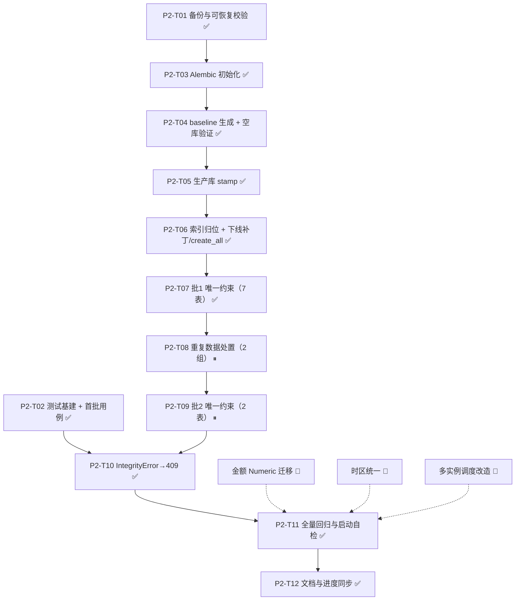

# TASK — 架构加固二期（结构地基）

> 阶段：6A 流程 · 阶段三（Atomize）
> 上游文档：[ALIGNMENT](file:///c:/Code/LifeOS2/docs/架构加固二期/ALIGNMENT_架构加固二期.md) / [DESIGN](file:///c:/Code/LifeOS2/docs/架构加固二期/DESIGN_架构加固二期.md)
> 图例：✅ 已完成（准备段）· ⏸ 待审批后执行 · 🚫 本阶段不做

## 1. 任务依赖图

## 2. 原子任务

### P2-T01 数据库备份与可恢复校验 ✅

- **输入契约**：生产库 `lifeos2` 可连接；`mysqldump` 路径可用（`.env` 的 `MYSQLDUMP_PATH`）。
- **输出契约**：`backend/backups/正式备份_<ts>.sql`，大小 > 2MB，退出码 0；文件头含 `MySQL dump 10.13 ... Database: lifeos2`。
- **验收标准**：文件存在、时间戳为本次执行时间、大小与历史备份同量级（本次 2,326,436 字节）。
- **实际产出**：`正式备份_20261102_183230.sql`。

### P2-T02 测试基建与首批用例 ✅

- **输入契约**：Python 3.10；无外部数据库服务。
- **输出契约**：`requirements-dev.txt`、`pytest.ini`、`tests/conftest.py`、5 个用例文件。
- **验收标准**：`python -m pytest` 全绿（本次 41 passed），不修改任何现有依赖版本。
- **约束**：不改 schema、不引入 Alembic、不锁定版本。

### P2-T03 Alembic 初始化 ✅

- **依赖**：决策 2、决策 3 已拍板。
- **输入契约**：`backend/` 可写；`alembic` 依赖加入 `requirements.txt`（新增，不升级现有）。
- **输出契约**：`backend/alembic.ini`、`backend/alembic/env.py`、`script.py.mako`；`env.py` 读取 `settings.DATABASE_URL`，`target_metadata=Base.metadata`，开启 `compare_type` 与 `compare_server_default`。
- **验收标准**：`alembic current` 可执行且不报错；`alembic history` 为空。
- **约束**：不执行 `alembic upgrade`，本任务只搭骨架。

### P2-T04 baseline 生成与空库验证 ✅

- **依赖**：P2-T03。
- **输入契约**：一个可随时清空的空库（例如 `lifeos2_fresh`）。
- **输出契约**：`backend/alembic/versions/943429348ec7_baseline_现有_61_张表与_11_条复合索引.py`（完整 61 表 + 11 索引）。
- **验收标准**：空库 `alembic upgrade head` 成功；`SELECT COUNT(*) FROM information_schema.tables WHERE table_schema='lifeos2_fresh'` = 61 + `alembic_version`；11 条索引存在；`alembic downgrade base` 可清空。
- **约束**：**不得对生产库执行 baseline 的 upgrade**。

### P2-T05 生产库 stamp ✅

- **依赖**：P2-T04 空库验证通过。
- **输入契约**：生产库可用；已再次备份。
- **输出契约**：`alembic_version` 表 1 行，值为 `943429348ec7`。
- **验收标准**：`alembic current` 显示 baseline；`alembic upgrade head` 为 no-op（不执行任何 DDL）；表结构与 stamp 前完全一致（对比 `SHOW CREATE TABLE` 摘要）。
- **约束**：只允许 `stamp`，不允许 `upgrade`。

### P2-T06 索引归位 + 下线启动补丁与 create_all ✅

- **依赖**：P2-T05（版本指针就位，避免应用启动再改结构）。
- **输入契约**：11 条索引清单（DESIGN 2.3 表）。
- **输出契约**：
  1. 11 条 `Index(...)` 写入对应模型 `__table_args__`；
  2. 删除 `app/core/db_indexes.py` 及 `main.py` 中的调用；
  3. 删除 `main.py` 中 `Base.metadata.create_all`（按决策 3）；
  4. 不新增空修订：autogenerate 存在 67 条历史漂移（见 ACCEPTANCE），漂移对齐另立专项。
- **验收标准**：`alembic check` 的差异中不出现本次 11 条复合索引（其余为 67 条历史漂移，见 ACCEPTANCE）；重启后 `information_schema` 仍显示 11 条索引；空库 `upgrade head` 后 11 条索引存在。
- **约束**：不得改动索引名与字段；不得同时改动业务逻辑。

### P2-T07 批 1 唯一约束（7 张无重复表） ✅

- **依赖**：P2-T06（索引已归位，模型稳定）。
- **输入契约**：DESIGN 3.1 表中 #1~#7。
- **输出契约**：模型 `__table_args__` 增加 7 个 `UniqueConstraint`；`backend/alembic/versions/3fd6b94691f3_add_7_unique_constraints.py` 对应 7 条 `ALTER TABLE ... ADD CONSTRAINT ... UNIQUE`（含 down_revision 回滚）。
- **验收标准**：`information_schema.table_constraints` 可查到 7 个约束；重复插入同键返回 409（配合 T10）或 IntegrityError；存量行数不变。
- **约束**：执行前再次运行只读重复统计，结果必须为 0 才继续。

### P2-T08 重复数据处置（2 组） ⏸

- **依赖**：P2-T07 完成（证明工具链可用）；**决策 1 已拍板为方案 A**。
- **输入契约**：`health_medication` 1 组重复（2 行）、`finance_loan_bills` 1 组重复（2 行）。
- **输出契约**：两组明细导出至 `backend/backups/dup_<table>_<ts>.csv`；按「保留 id 最大」删除旧行；执行前后统计各 1 次。
- **验收标准**：清理后重复组数 = 0；删除行数 = 2；导出文件可回读；删除明细写入操作说明（含原始字段值）。
- **约束**：必须人工确认后才执行 DELETE；不允许在迁移脚本里做数据删除。

### P2-T09 批 2 唯一约束（2 张表） ⏸

- **依赖**：P2-T08 统计为 0。
- **输入契约**：DESIGN 3.1 表中 #8~#9。
- **输出契约**：2 个 `UniqueConstraint` + 迁移修订（`ALTER TABLE ... ADD CONSTRAINT ... UNIQUE`）。
- **验收标准**：约束可查；重复插入被拒；`downgrade` 可撤销。
- **约束**：NULL 语义限制需写进迁移注释（`platform_id` 可空时不去重）。

### P2-T10 IntegrityError → 409 映射（按决策 4） ✅

- **依赖**：P2-T02、P2-T09。
- **输入契约**：`crud_router` 的 create/update/batch 三个写入口。
- **输出契约**：统一捕获 `IntegrityError` → `HTTPException(409, "已存在相同记录（唯一约束冲突）")`；新增 API 层用例验证 409。
- **验收标准**：成功路径响应不变；重复写入用例通过；日志记录 `exc.orig` 便于排查。
- **约束**：不得改变现有 409 文案语义（与 `_raise_if_conflict` 对齐）。

### P2-T11 全量回归与启动自检 ✅

- **依赖**：P2-T06 ~ P2-T10。
- **输入契约**：最新 master；生产库已完成迁移。
- **输出契约**：`python -m pytest` 全绿；`GET /api/v1/health` = ok（database ok、schedulers running）；关键写接口冒烟通过。
- **验收标准**：无 5xx；迁移后表行数/关键聚合值与迁移前一致；回滚演练（`alembic downgrade -1` + `upgrade head`）成功。
- **约束**：冒烟只读为主，写操作使用测试账号。

### P2-T12 文档与进度同步 ✅

- **依赖**：P2-T11。
- **输出契约**：更新 `说明文档.md` 进度记录；补 `ACCEPTANCE_架构加固二期.md`；如需，补 `FINAL`/`TODO`。
- **验收标准**：进度记录含日期、完成项、验证结论；文档间引用可点击。
- **约束**：不改写全文，只追加。

## 3. 任务执行顺序与提交划分

| 批次 | 任务 | 提交粒度 |
|------|------|----------|
| 批 A | P2-T03 | 1 次提交（Alembic 骨架） |
| 批 A | P2-T04 | 1 次提交（baseline 脚本 + 空库验证记录） |
| 批 A | P2-T05 | 不产生代码提交（只写 DB 版本指针，记录到文档） |
| 批 B | P2-T06 | 1 次提交（索引归位 + 删补丁/删 create_all） |
| 批 C | P2-T07 | 1 次提交（模型 + 批 1 迁移） |
| 批 C | P2-T08 | 1 次提交（清理脚本 + 统计输出，脚本如无长期价值不提交） |
| 批 C | P2-T09 | 1 次提交（模型 + 批 2 迁移） |
| 批 D | P2-T10 | 1 次提交（409 映射 + 用例） |
| 批 E | P2-T11 | 1 次提交（如有回归修复） |
| 批 E | P2-T12 | 1 次提交（文档同步） |

## 4. 全局约束（所有任务适用）

1. 不执行任何 DDL 直到用户批准本文件与 ALIGNMENT 决策清单。
2. 不升级现有依赖版本、不锁版本（Alembic 属新增依赖）。
3. 不改前端、不改 API 成功路径契约。
4. 每个任务单独提交、中文提交信息、推送 master。
5. 新增/修改函数必须有函数级注释（功能、参数、返回值）。
6. 任何一步失败：立即停止、记录证据、不越权修改数据。
