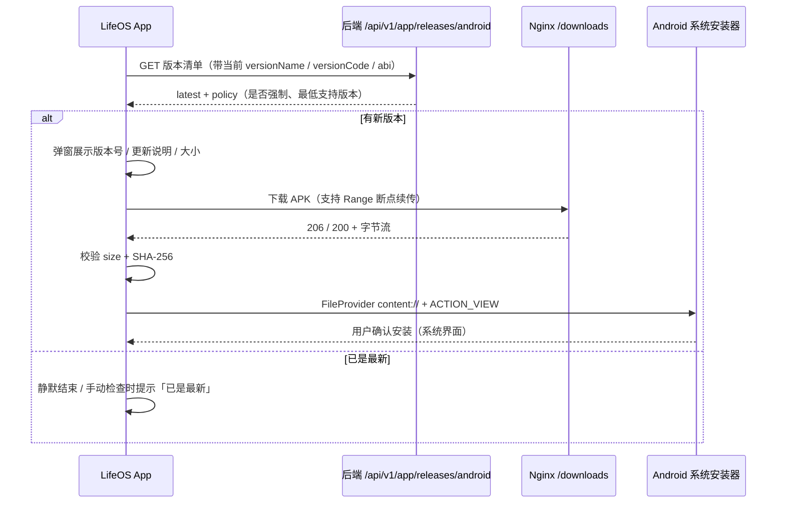

# 移动端「检查更新」方案研究

> 状态：研究 / 方案，不含代码改动，不安装依赖，不接触服务器。
> 基准：`master`，移动端 `mobile/`，后端 `backend/`；产物数据于 2026-11-15 复核。
> 目标：回答两件事——移动端检查更新走哪条路线、自建路线具体怎么设计；并把无法绕开的 Android 硬限制写清楚。

---

## 0. 结论先行

| 项 | 结论 |
|---|---|
| 推荐路线 | **自建版本接口 + 应用内下载 + 拉起系统安装器**，APK 与版本清单放在现有服务器上。 |
| 不建议作为主路线 | 国内应用商店（个人主体 + 健康/金融类目门槛高）；第三方平台只建议做内测/备份镜像，不做唯一分发渠道。 |
| 签名现状 | release 直接复用 debug 签名配置（Flutter 模板默认），实测证书为 `CN=Android Debug`。**唯一风险是 debug.keystore 丢失或换构建机后无法覆盖升级**；keystore 已备份（见 §3.4），因此不构成阻塞。 |
| 大致工作量 | 3–5 人日（不含商店上架）。 |
| 强制更新原则 | 只在接口不兼容时启用；软提示优先；离线 fail-open；必须保留网页端兜底和服务器侧开关。 |

---

## 1. 现状核对（先读仓库，再谈方案）

### 1.1 移动端

| 项 | 现状 | 依据 |
|---|---|---|
| 框架 | Flutter 3.47.9（stable），Dart SDK `^3.13.7` | [P0_环境勘察.md](../移动端可行性研究/P0_环境勘察.md)、[pubspec.yaml](../../mobile/pubspec.yaml#L21-L23) |
| 包名 / SDK | `com.lifeos.mobile`，`minSdk 26`，`targetSdk 36`，`versionName = pubspec.version`，`versionCode = pubspec.buildNumber` | [build.gradle.kts](../../mobile/android/app/build.gradle.kts#L18-L29) |
| 版本号位置 | `pubspec.yaml` 的 `version: 1.0.0+1`（构建时可用 `--build-number` 覆盖） | [pubspec.yaml](../../mobile/pubspec.yaml#L19) |
| 版本读取 | 已依赖 `package_info_plus`，关于页只显示 `version`，未显示构建号 | [about_page.dart](../../mobile/lib/features/settings/about_page.dart#L9-L40) |
| 检查更新 | **当前没有**；关于页明确写「后端没有版本 / 更新检查接口」，并刻意不放按钮 | [about_page.dart](../../mobile/lib/features/settings/about_page.dart#L103-L107) |
| 后端地址 | 可在「设置 → 服务器地址」修改，默认 `http://192.168.8.103:9515/api/v1` | [app_config.dart](../../mobile/lib/core/config/app_config.dart#L5-L9)、[server_config_page.dart](../../mobile/lib/features/settings/server_config_page.dart#L37-L49) |
| 明文 HTTP | `android:usesCleartextTraffic="true"`，用于局域网 HTTP | [AndroidManifest.xml](../../mobile/android/app/src/main/AndroidManifest.xml#L27-L32) |
| 安装权限 | **没有** `REQUEST_INSTALL_PACKAGES`，也没有 FileProvider 声明 | [AndroidManifest.xml](../../mobile/android/app/src/main/AndroidManifest.xml) |
| ABI | 既有 universal 通用包，也保留过 11-08 的 split-per-abi 产物 | 见下 |

### 1.2 现有构建产物（实测，不是推测）

**当前对外包（2026-11-15 构建）**

| 项 | 值 |
|---|---|
| 路径 | `mobile/build/app/outputs/apk/release/app-release.apk`，与 `mobile/build/app/outputs/flutter-apk/app-release.apk` **是同一个文件**（SHA-256 一致） |
| 体积 | 63,239,430 字节 |
| `versionCode` / `versionName` | **2006** / 1.0.0 |
| ABI | arm64-v8a / armeabi-v7a / x86_64（三合一通用包） |
| 构建时间 | 2026-11-15 12:03 |
| SHA-256 | `E0FF5761C7575F1E84B168304182FD204930E3255E943A7622407DC9EB98248E` |

**历史产物（2026-11-08 构建，同目录仍在）**

| 产物 | 体积 | `versionCode` | `versionName` | ABI |
|---|---|---|---|---|
| `app-arm64-v8a-release.apk` | 22,065,052 字节 | **2001** | 1.0.0 | arm64-v8a |
| `app-armeabi-v7a-release.apk` | 19,713,784 字节 | **1001** | 1.0.0 | armeabi-v7a |
| `app-x86_64-release.apk` | 23,622,052 字节 | **4001** | 1.0.0 | x86_64 |
| `app-debug.apk` | 101,975,865 字节 | 1 | 1.0.0 | 三 ABI |

- 实测命令：`aapt dump badging`、`apksigner verify --print-certs`、`Get-FileHash`。
- **签名实测**：`Signer #1 certificate DN: C=US, O=Android, CN=Android Debug`，SHA-256 `ebbe0aaa…39b6`，与本机 `~/.android/debug.keystore` 完全一致。签名方案 v2 开启、v1 关闭（minSdk 26 无影响）；Manifest 无 `debuggable`，是真正的 release 构建。
- **63 MB 与 22 MB 不是同类产物，不能直接比大小**：63 MB 是**通用包**，把三个 ABI 的原生库全打进一个 APK；22 MB 是**单架构**产物（量级与上表 arm64 拆分包的 22.07 MB 一致）。实测拆解如下，通用包体积 100% 来自三份 ABI 原生库：

  | 分组 | universal | arm64 拆分 |
  |---|---|---|
  | `arm64-v8a/lib` | 20,947,416 | 20,947,416 |
  | `armeabi-v7a/lib` | 18,593,304 | — |
  | `x86_64/lib` | 22,505,752 | — |
  | `dex` | 487,167 | 487,167 |
  | `res` | 274,105 | 274,105 |
  | `assets/flutter_assets` | 136,052 | 135,800 |
  | 其他（Manifest、META-INF、resources.arsc 等） | 124,266 | 124,266 |

  arm64 与 x86_64 的库在通用包里与拆分包里**字节数完全一致**，共享部分（dex / res / assets）也一致 → 体积差异只由「多带了两份 ABI 原生库」造成，不存在 tree-shaking、obfuscate、split-debug-info 之类的额外成因。三份库相加 62.0 MB，本身就是通用包的主体。

- **versionCode 实测存在跨变体差异**：通用包 `2006`，拆分产物 `1001 / 2001 / 4001`。规律是「基础 `versionCode` + 1000 × ABI 代号」（v7a=1、arm64=2、x86_64=4），拆分时 Flutter 会自动加偏移；通用包没有 ABI filter，不加偏移，`2006` 就是构建时 `--build-number 2006` 的原值（pubspec 静态是 `1.0.0+1`，只按 pubspec 会出 `versionCode=1`）。因此**不能拿一个 APK 的 versionCode 去和另一个变体比较**。详见 §3.3。

### 1.3 后端

| 项 | 现状 | 依据 |
|---|---|---|
| 框架 / 前缀 | FastAPI，统一前缀 `/api/v1` | [config.py](../../backend/app/core/config.py#L14-L17) |
| 匿名接口先例 | `/api/v1/health`、`/api/v1/site-config` 均匿名可读 | [health_check.py](../../backend/app/api/routes/health_check.py#L73-L93)、[site_config.py](../../backend/app/api/routes/site_config.py#L125-L129) |
| 版本 / 更新接口 | **不存在**（全仓未找到 app version / release 路由） | 仓库检索结果 |
| 静态文件 | 只有头像挂载在 `/api/v1/uploads/avatars`，没有 APK 托管 | [main.py](../../backend/app/main.py#L192-L198) |
| 迁移 | Alembic 共 3 个版本，baseline 为「现有 61 张表」 | `backend/alembic/versions/` |
| 部署形态 | README 给的是单机 Nginx + systemd + MySQL，HTTP 9515 | [README.md](../../README.md#L290-L460) |

### 1.4 前端 / 分发

- 前端固定请求相对路径 `/api/v1`（[api.ts](../../frontend/src/lib/api.ts#L1)），与后端同源部署时不需要改地址。
- 前端是纯静态 SPA，`dist/` 由 Nginx 托管，`vercel.json` 已示范 SPA 重写。
- **没有** APK 下载页、没有版本清单、没有 CI；`docs/移动端可行性研究/APK_开发方案.md` 只写了「内网 APK 下载页 + App 内检查更新」的方向，没有落地。

---

## 2. 路线对比

### 2.1 总览

| 路线 | 首次成本 | 长期维护 | 可控性 | 合规 / 隐私风险 | 主要失败模式 | 结论 |
|---|---|---|---|---|---|---|
| **A. 自建版本接口 + 应用内下载安装** | 中（3.5–6 人日） | 低 | **最高**：版本、灰度、强制策略、下载地址全在自己手里 | 低：二进制只放自己服务器；不引入第三方 SDK | 厂商 ROM 拦截、未知来源权限、下载中断 | **主路线** |
| B. 第三方分发（蒲公英 / fir.im 等） | 低（上传即用） | 中：平台规则、有效期、资费会变 | 低：下载页/统计/限流受平台控制 | 中：APK 交给第三方托管；平台会扫描、留存；隐私政策需说明 | 链接失效、免费额度/有效期限制、平台停服 | 仅内测或备用 |
| C. GitHub Releases | 低 | 低 | 中：版本资产清楚，但依赖 GitHub 可达性 | 中：仓库是公开的，Release 资产也公开可下载 | 国内网络不稳定；GitHub API 限流 | 可做**镜像**，不做主渠道 |
| D. 国内应用商店 | 高（资质 + 审核 + 长期维护） | 高 | 低：审核、下架、版本节奏都不由自己 | **高**：软著、App 备案、隐私政策、权限清单、实名；健康/金融类目对个人主体更严 | 审核不通过、类目受限、更新被卡 | **不做** |
| E. 纯手工下载页（不做应用内检查） | 最低 | 低 | 中 | 低 | 用户不知道有新版本；每次靠人通知 | 作为兜底，不作为体验方案 |

### 2.2 各路线要点

**成本口径（费用 + 人力 + 等待时间）**

| 路线 | 费用 | 人力 | 等待/不确定性 |
|---|---|---|---|
| A 自建 | 无平台费；复用已有服务器/域名 | 3.5–6 人日 | 仅受自己发布节奏影响 |
| B 第三方 | 免费档有限制，付费档以平台为准 | 0.5 人日（上传 + 配置） | 平台审核、额度、有效期、停服 |
| C GitHub Releases | 免费 | 0.5 人日 | 国内访问稳定性、限流 |
| D 应用商店 | 开发者账号/软著/备案等费用 | 数人日 + 长期维护 | 数周审核，且可能被拒 |
| E 纯下载页 | 0 | 0.5 人日 | 无，但用户不会主动更新 |

**A. 自建**

- 成本：后端一个匿名接口 + 一个静态下载目录 + App 侧检查/下载/安装；无平台费。
- 可控性：能按渠道、按最低支持版本、按强制策略控制；能随时回滚清单；能看自己 Nginx 日志的下载量。
- 合规：APK 只放在自己的服务器，数据仍全部在自有后端；不需要向第三方申报用户数据。
- 风险：Android 安装环节的系统/ROM 限制无法绕过（见 §3.6）。

**B. 蒲公英 / fir.im**

- 蒲公英（Pgyer）：上传 APK 生成短链/二维码，带版本历史；免费版通常有限流、有效期、下载页品牌等限制，付费版才放开。具体资费与政策**以官网当前页面为准**，本仓库无法验证。
- fir.im：历史上常用，但服务可用性、资费、是否仍适合长期托管**必须先核实**，不要把更新链路建在一个不确定的服务上。
- 共同问题：APK 交给第三方，平台会做安全扫描并留存文件；链接可能被平台策略限制；免费额度用完会直接断掉更新链路。
- 适合：内部试用、临时发几个测试包；不适合作为唯一主渠道。

**C. GitHub Releases**

- 优点：免费、版本资产天然带 tag、可直接 `releases/latest/download/...`。
- 现实问题：`ZeroOneCN/LifeOS2` 是公开仓库，Release 里的 APK 也等于公开分发；国内访问 GitHub 的稳定性不可控；GitHub API 对未认证请求有限流。
- 适合：作为备用下载镜像，主接口仍指向自己的域名。

**D. 国内应用商店**

- 需要：软件著作权、App 备案（工信部）、隐私政策、权限清单、实名主体；部分商店还要求 ICP 备案、算法/安全评估。
- 健康、财务类目对个人开发者审核更严；每次更新要重新审核，无法做到「改完就发」。
- 本项目是「自建服务器 + 个人数据」的工具型 App，商店分发的收益很低，合规成本很高，**明确不做**。

---

## 3. 自建路线详细设计

### 3.1 端到端流程



### 3.2 版本接口契约

建议新增匿名接口（不需要登录，登录页也能检查）：

```
GET /api/v1/app/releases/android?channel=stable&current_version_name=1.0.0&current_version_code=2006&abi=arm64-v8a
```

- 鉴权：无（与 `/health`、`/site-config` 一致）。版本清单不含任何用户数据。
- 缓存：`Cache-Control: no-cache` 或 5 分钟；客户端每次检查带时间戳绕过中间缓存。
- 响应：即使已是最新也返回 `200`，由客户端比较；不要用 404 表达「无更新」。

响应示例：

```json
{
  "manifest_version": 1,
  "platform": "android",
  "channel": "stable",
  "generated_at": "2026-11-15T12:30:00+08:00",
  "latest": {
    "version_name": "1.0.1",
    "version_code": 2007,
    "download_url": "https://lifeos.example.com/downloads/LifeOS-1.0.1-universal.apk",
    "sha256": "0123456789abcdef0123456789abcdef0123456789abcdef0123456789abcdef",
    "size": 63239430,
    "min_android_sdk": 26,
    "published_at": "2026-11-15T12:00:00+08:00",
    "signing_cert_sha256": "ebbe0aaac3a8df7b3d393895a6be9f0e2f6fdffd40b09dbe85cbcbe6544939b6",
    "release_notes": "1. 修复账单列表排序\n2. 新增体重秤重试"
  },
  "policy": {
    "min_supported_version_name": "1.0.0",
    "min_supported_version_code": 2006,
    "force": false,
    "grace_until": null,
    "force_reason": null
  }
}
```

字段说明：

| 字段 | 必填 | 说明 |
|---|---|---|
| `manifest_version` | 是 | 清单结构版本；客户端遇到未知版本时降级为「只读版本号」，不要崩 |
| `platform` / `channel` | 是 | 固定 `android` + `stable`；以后可扩展 beta |
| `latest.version_name` | 是 | 展示与语义比较用，必须严格 `major.minor.patch` |
| `latest.version_code` | 是 | 安装门槛；必须与 APK 内 `aapt dump badging` 的值一致 |
| `latest.download_url` | 是 | **绝对地址**，由服务端配置 `PUBLIC_BASE_URL` 拼出，不要用请求 `Host` 头拼（防 Host 注入） |
| `latest.sha256` | 是 | 小写 64 位十六进制；下载后必须校验 |
| `latest.size` | 是 | 字节数；用于剩余空间检查和完整性兜底 |
| `latest.release_notes` | 否 | 纯文本，最多 500 字；App 只做文本渲染，不渲染 HTML/Markdown |
| `latest.signing_cert_sha256` | 否 | 证书指纹；用于展示和排查，不能替代 Android 安装器校验 |
| `policy.min_supported_*` | 是 | 低于此版本才强制更新；不要用 `force: true` 单独表达 |
| `policy.force` | 是 | 服务端计算结果，便于客户端直接展示；客户端仍应自己按版本比较一次 |
| `policy.grace_until` | 否 | 强制生效的宽限截止时间；为空表示立即 |
| `policy.force_reason` | 否 | 展示给用户的简短原因（如「接口已升级」） |

实现建议：

- 清单来源用文件（如 `shared/downloads/android.json`）而不是数据库：单用户、单管理员、发布频率低，文件可审查、可回滚、可进发布脚本。
- 后端只负责读取与校验（字段完整性、`download_url` 与 `PUBLIC_BASE_URL` 同源、`sha256` 格式、`version_code` 单调），不要负责传输 63 MB APK；APK 由 Nginx 静态托管，天然支持 Range。
- 增加一个发布前校验脚本：文件存在、大小一致、SHA-256 一致、`aapt` 版本号一致、签名证书与清单记录一致。任何一项不通过就拒绝发布。

### 3.3 版本比较规则

**结论：展示用 `versionName`，安装门槛用 `versionCode`，两者必须成对出现。**

1. `versionName` 按 `major.minor.patch` 拆成三个整数比较，**禁止字符串比较**（`"1.10.0" < "1.9.0"` 的字符串结果是错的）。
2. 若 `versionName` 相同，再比较 `versionCode`；`versionCode` 更大视为更新（用于同日热修）。
3. 判断「低于最低支持版本」同样用「`versionName` 先比、`versionCode` 再比」的二元组，不要只拿 `versionCode` 比。
4. 客户端必须校验 `latest.version_code > 已安装 versionCode`，否则即使清单说新版也不能拉起安装器（Android 会拒绝降级）。
5. 服务端发布时保证 `versionCode` 单调递增；不允许回退版本号。

**ABI 偏移问题（本项目已实测）**

- 通用包实测 `versionCode=2006`（无 ABI filter，不加偏移，等于构建时 `--build-number`）；11-08 的拆分产物实测 `1001 / 2001 / 4001`，即「基础值 + 1000 × ABI 代号」。
- 如果清单只维护一个 `version_code`，而用户装的是另一个 ABI 变体，就会出现「同版本却提示更新」或「真更新却判定已是最新」。
- 三种处理方式，按推荐顺序：
  1. **只发 universal APK**（当前通用包 63.2 MB；个人使用 + Wi-Fi 提示可接受）。清单只维护一个 `version_code`，客户端不需要上报 ABI。发布脚本用 `aapt dump badging` 实测后写清单。
  2. 若坚持拆 ABI：接口带 `abi` 参数（移动端已依赖 `device_info_plus`，可读 `supportedAbis`），清单按 ABI 返回各自的 `version_code` 与下载地址；**禁止跨 ABI 比较 `versionCode`**。
  3. 用构建参数强制忽略 ABI 偏移（[build.gradle.kts](../../mobile/android/app/build.gradle.kts#L23-L26) 注释提到 `-P force-version-code-ignoring-abi=true`），但必须重新实测确认产物 `versionCode`；不能只信注释。

### 3.4 下载与校验

| 环节 | 设计 |
|---|---|
| 协议 | 只允许 HTTPS；`http://` 仅保留给局域网调试，且要在 UI 上明确提示不安全 |
| 保存位置 | App 私有外部目录（`getExternalStorageDirectory()/updates/`），不需要存储权限；Android 10+ 分区存储下仍可写自己的目录 |
| 空间检查 | 下载前检查可用空间 ≥ `size * 1.2`；不足时提示清理，不开始下载 |
| 断点续传 | 首次记录 `ETag` / `Last-Modified`；续传带 `Range: bytes=<已下载>-` 与 `If-Range`；服务端返回 `206` 才续传，返回 `200` 则从头开始 |
| 完整性 | 下载完成后校验 `size` 与 `sha256`；不匹配立即删除临时文件并提示重试，**绝不拉起安装器** |
| 超时 | 下载请求不要沿用 `ApiClient` 的 15 秒 receiveTimeout；单独长超时 + 进度回调 + 可取消 |
| 失败重试 | 网络失败可重试 1 次；哈希失败不自动重试，直接报错并给出下载页地址 |
| 安装包类型 | 响应头 `Content-Type: application/vnd.android.package-archive`；Nginx 需显式配置该 MIME（默认可能识别为 `application/octet-stream`） |
| 校验签名 | Android 安装器会强制校验「同包名 + 同签名证书」；App 侧可在下载后用原生 `PackageManager.getPackageArchiveInfo` 预检证书指纹，给出更清楚的中文错误，但不能替代系统校验 |

**签名现状与唯一风险**

- 现状：`build.gradle.kts` 的 `release` 直接复用 `signingConfigs.getByName("debug")`（[build.gradle.kts](../../mobile/android/app/build.gradle.kts#L31-L37)，Flutter 模板默认行为），实测证书 `CN=Android Debug`，SHA-256 `ebbe0aaa…39b6`，来自本机 `~/.android/debug.keystore`。这是当前**有意维持**的发布方式，不是待修缺陷。
- 风险只有一条：**debug.keystore 丢失或换构建机**，新 keystore 生成的证书不同，已装包无法覆盖升级，会报 `INSTALL_FAILED_UPDATE_INCOMPATIBLE`，只能卸载重装（服务端数据不受影响，本地登录态与偏好会丢）。
- 已有备份：`C:\Users\Administrator\OneDrive\LifeOS-backup\debug.keystore`（2,618 字节，备份于 2026-11-06，SHA-256 `79037CA5B6F8C95D6F4C21F791A3BD5CA485E687FC62047375B8928FC374E0F4`）。换机或重装系统时，把这个文件放回 `%USERPROFILE%\.android\debug.keystore` 即可继续覆盖升级；恢复后用 `keytool -list -v` 核对指纹是否为 `EB:BE:0A:AA:…:39:B6`。
- 发布前仍要执行 `apksigner verify --print-certs` 并把实际指纹写进版本清单 —— 不是为了「证明是正式证书」，而是为了能立刻发现签名漂移。
- 若将来要换成正式 keystore：那一刻等于一次强制「卸载重装」断点，且不可逆；不换则无此问题。

### 3.5 拉起系统安装器需要什么

#### Manifest 增量

```xml
<!-- 允许 App 请求安装其他 APK（仅侧载/自建分发需要；上架商店时该权限受限制） -->
<uses-permission android:name="android.permission.REQUEST_INSTALL_PACKAGES" />

<application ...>
    <provider
        android:name="androidx.core.content.FileProvider"
        android:authorities="${applicationId}.fileprovider"
        android:exported="false"
        android:grantUriPermissions="true">
        <meta-data
            android:name="android.support.FILE_PROVIDER_PATHS"
            android:resource="@xml/file_paths" />
    </provider>
</application>
```

`res/xml/file_paths.xml`：

```xml
<paths>
    <external-files-path name="updates" path="updates/" />
</paths>
```

- `minSdk 26`，所以 FileProvider 是**必需**的（Android 7.0+ 禁止 `file://` 跨应用传递）。
- 如果使用第三方「打开文件/安装 APK」插件，要先确认它自己声明了哪个 `FileProvider authority`，避免和上面的 authority 冲突（manifest 合并会直接报错）；优先自己写一个很薄的 MethodChannel，行为最可控。

#### 权限与 Intent 流程

1. 检查 `packageManager.canRequestPackageInstalls()`（API 26+）。
2. 为 `false` 时，跳 `Settings.ACTION_MANAGE_UNKNOWN_APP_SOURCES`，URI 为 `package:<applicationId>`；用户返回后再次检查。
3. 用 `FileProvider.getUriForFile()` 生成 `content://` URI。
4. `Intent(ACTION_VIEW)` + `setDataAndType(uri, "application/vnd.android.package-archive")` + `FLAG_GRANT_READ_URI_PERMISSION | FLAG_ACTIVITY_NEW_TASK`。
5. `startActivity` 外层必须 `try/catch ActivityNotFoundException`：个别 ROM 没有标准安装器，失败时退化为「打开下载页」。
6. 不要用 `file://`；不要申请 `WRITE_EXTERNAL_STORAGE` 来写自己的目录（分区存储下不需要）。

#### Android 版本差异

| 版本 | 影响 | 应对 |
|---|---|---|
| Android 8.0（API 26） | 「安装未知来源应用」改为**按 App 授权** | 每次安装前检查 `canRequestPackageInstalls()`，不要假设已授权 |
| Android 9（API 28） | 明文 HTTP 默认禁止 | 本 App 已开 `usesCleartextTraffic`；生产建议 HTTPS |
| Android 10（API 29） | 分区存储 | 下载到 App 私有外部目录，不写公共 `Downloads` |
| Android 11（API 30） | 包可见性；`resolveActivity` 可能返回 null | 需要 `queries` 声明安装器 intent，或直接 `startActivity` 并 catch |
| Android 12–13 | 通知权限、精确闹钟（与安装无直接关系） | 不要混在更新流程里申请无关权限 |
| Android 14–16 | targetSdk 门槛、厂商安装器更严、后台限制更紧 | 以真机实测为准；本项目 targetSdk 36，必须覆盖 Android 14+ 设备 |

### 3.6 无法绕开的硬限制（必须写进产品预期）

1. **不能静默安装**。普通 App 没有 `INSTALL_PACKAGES` 系统权限；只有 Device Owner / MDM / 系统签名 / 定制 ROM 才能静默装。任何「下载完自动装好」的承诺都是假的。
2. **每次安装都要用户在系统界面点确认**。部分 ROM 还要二次确认、指纹/密码、关闭「纯净模式」、允许「安装外部来源应用」。
3. **厂商会拦截**。MIUI/HyperOS、ColorOS、OriginOS、EMUI 等会扫描 APK，可能提示「风险应用」「未经备案」「建议前往应用商店」，甚至默认阻止；Play Protect 也会扫描。App 无法绕过，只能给出引导文案。
4. **安装过程会杀死当前 App**。装完后无法可靠地自动重启并回到原页面；不要设计「安装完自动登录继续」的强承诺。
5. **降级不可能**。`versionCode` 更低会被系统拒绝；想回退只能卸载重装。
6. **ABI 必须匹配**。拆分包发错 ABI 会装失败；个人项目建议 universal 包。
7. **未知来源权限可能被 ROM 重置**。系统升级、清理软件、安全中心都可能关掉它，每次都要重新检查。
8. **没有 iOS 对应物**。iOS 不允许应用内下载安装，只能走 TestFlight/App Store；本项目当前只做 Android。
9. **网络限制**。通用包 63 MB，移动数据下必须提示「建议 Wi-Fi」并显示体积；下载页被微信/QQ 内置浏览器拦截时，要提示「用系统浏览器打开」。

### 3.7 强制更新怎么设计才不会把用户锁死

**分级策略**

| 级别 | 触发条件 | 交互 |
|---|---|---|
| 可选更新 | `latest` 比当前新，但当前 ≥ `min_supported` | 弹窗：稍后 / 立即更新；7 天内不再自动弹 |
| 建议更新 | 同上，但发布说明含重要修复 | 每次启动提示，可稍后 |
| 强制更新 | 当前 < `min_supported`，且 `grace_until` 已过 | 全屏页：只能「下载并安装」或「打开网页端」 |

**硬规则（防止把自己锁在门外）**

1. `min_supported` **只在接口/数据格式真正不兼容时提升**；UI 改动、文案改动一律不强制。
2. 发布顺序必须是：先发布可下载的新 APK → 观察 1–2 周 → 再提升 `min_supported`；绝不能先提最低版本再传包。
3. 强制页必须同时提供：**下载按钮、可复制的直链、网页端地址**。App 装不上时，用户还能用浏览器登录。
4. 清单接口不可达时 **fail-open**：不因为「检查不到更新」而阻止启动或登录；只有拿到明确的 `min_supported` 才展示强制页。
5. 强制页的下载失败要能重试、能复制链接、能打开系统浏览器；不能只有一个「重试」死循环。
6. 服务端保留一个**开关文件/配置**（如 `force: false`），不改 App、不发版即可解除强制。
7. 至少保留最近 3 个 APK 的可下载地址；永远不要删掉当前 `min_supported` 对应的安装包。
8. 提供一个仅限机主的逃生口：关于页连续点版本号 7 次可临时跳过强制 24 小时（仅在后端仍接受旧接口时有效；后端已拒绝时自然无效）。单人自用项目值得保留这个口子。
9. 不要在登录失败/网络错误时叠加强制弹窗；强制页应能在登录页之前独立展示。
10. 若要更严格，可在后端加「客户端版本中间件」：低于最低版本返回 `426 Upgrade Required`，响应体带 `min_supported`；客户端统一拦截并跳强制页。该中间件是第二阶段，不要和第一版同时上，避免一开始就把自己锁死。

---

## 4. 第三方与商店补充说明

### 4.1 第三方平台的使用边界

- 只把第三方当作**内测分发**：发给 1–3 台设备、短期有效；正式更新仍走自建。
- 上传前用同一把签名出包、校验 SHA-256；第三方页面上的 APK 和自建服务器上的必须是同一个文件（同哈希）。
- 如果平台要求填写应用信息、隐私政策、权限说明，按实际情况填写，不要填「不收集数据」却实际会上传手机号/健康数据。

### 4.2 商店上架门槛（为什么不做）

- 国内主流商店普遍要求：软件著作权证书、App 备案、企业/个人实名、隐私政策、权限清单；健康与金融类目还可能要求相关资质。
- 每次版本更新都要审核，无法做到「修完立刻发」；本项目更新频率和自用属性都不适合。
- Google Play 另有开发者账号费用、Data safety 表单、targetSdk 年度要求；健康/金融类审核更严。
- 结论：**不上架**。把精力放在自建链路和签名体系上。

---

## 5. 推荐落点与工作量

### 5.1 推荐方案

1. **签名保持一致**：继续用 release + debug 签名（现状），把 `debug.keystore` 备份当发布资产对待；`versionCode` 单调递增。不引入 `applicationIdSuffix`。
2. **只发 universal APK**：通用包 63.2 MB，规避 ABI 偏移与多渠道矩阵；如后续要拆 ABI 或想减小体积，再按 §3.3 方案 2 扩展。
3. **后端新增匿名版本接口**，清单文件放 `shared/downloads/android.json`，APK 由 Nginx `/downloads/` 静态托管。
4. **App 内新增更新服务 + 更新页**：启动时静默检查（24 小时节流）、关于页手动检查、弹窗/全屏强制页、下载进度与断点续传、哈希校验。
5. **Android 侧薄桥接**：FileProvider + 未知来源权限 + `ACTION_VIEW`；优先自写 MethodChannel，避免插件 authority 冲突。
6. **发布脚本**：版本号递增 → 构建 → `aapt`/`apksigner` 校验 → SHA-256 → 上传 → 原子替换清单 → `curl` 复核。

### 5.2 工作量估算（单人 + AI 协作）

| 工作项 | 内容 | 人日 |
|---|---|---|
| 后端版本接口 | 路由、清单校验、配置项、单元测试 | 0.5–1 |
| 静态托管与发布脚本 | Nginx `/downloads/`、清单原子替换、校验脚本 | 0.5 |
| Flutter 更新服务 | 检查、比较、下载、断点续传、哈希、缓存策略 | 1–1.5 |
| 更新 UI | 弹窗、强制页、进度、失败态、关于页入口 | 0.5–1 |
| Android 安装桥接 | FileProvider、权限引导、Intent、异常兜底 | 0.5–1 |
| 真机验证 | 2 个 ROM、375 宽 + 1.3x 字体、断网/断点续传 | 0.5–1 |
| **合计** | 不含商店上架；签名维持现状，无需整改工时 | **3–5 人日** |

### 5.3 前置条件

- [x] 签名维持 release + debug 签名；`debug.keystore` 已备份到 `C:\Users\Administrator\OneDrive\LifeOS-backup\`（指纹已核对），换机时放回 `%USERPROFILE%\.android\` 即可继续覆盖升级。
- [ ] 已有固定 HTTPS 域名（或至少固定 IP + 受信任证书），否则下载地址无法稳定写进清单。
- [ ] 服务器有可写目录放 APK 与清单，Nginx 能托管 `/downloads/`。
- [ ] 明确发布纪律：先传包、后改最低版本；`versionCode` 只增不减。
- [ ] 真机覆盖至少一个国产 ROM（本项目测试机为 23127PN0CC / Android 16，见 P1 文档），验证未知来源与安装器行为。

---

## 6. 验收清单

- [ ] 已是最新时，手动检查提示「已是最新」，启动检查不打扰用户。
- [ ] 有新版本时，版本号、大小、更新说明展示正确；「稍后」在 7 天内不再自动弹。
- [ ] 下载中断后再次点击可续传（服务端返回 `206`）；不支持 Range 时自动从头下载。
- [ ] 下载完成后 SHA-256 校验通过；篡改文件会被拒绝且不拉起安装器。
- [ ] 未授权「安装未知来源」时，能正确跳到本 App 的授权页；返回后状态刷新。
- [ ] 同一签名（debug 证书）的新包能覆盖安装旧包，登录态与服务端数据不受影响；签名指纹与清单记录不一致时安装器会拒绝，需给出明确提示。
- [ ] 强制更新页可下载、可复制直链、可打开网页端；断网时不误锁。
- [ ] 清单不可达、清单字段缺失、`download_url` 404 时都有可理解的错误与兜底链接。
- [ ] 通用包与拆分包的 `versionCode` 已用 `aapt dump badging` 实测并写入清单，不靠猜（当前：通用 2006、arm64 2001、v7a 1001、x86_64 4001）。
- [ ] 至少 2 个 ROM 实测：未知来源开关、安装确认、安装后 App 被杀、重新打开正常。

---

## 7. 待验证项（不要在实现时当成已确认）

1. **通用包的 versionCode**：已实测 2026-11-15 通用包为 `2006`（无 ABI filter，不偏移），11-08 拆分包为 `1001 / 2001 / 4001`。结论已确认，不再是待验证项；但每次换构建方式（是否 `--split-per-abi`、是否传 `--build-number`）都要重新用 `aapt` 实测。
2. **具体 ROM 行为**：测试机 23127PN0CC / Android 16 的实际安装器流程、是否触发「风险应用」、是否允许从 App 私有目录安装，需要在真机上逐项验证。
3. **FileProvider 方案**：自写 MethodChannel 与第三方插件（如 `open_filex`）的 authority、`queries`、Android 14+ 行为需实测；本文件不指定具体插件版本。
4. **蒲公英 / fir.im 的当前资费与服务状态**：以官网为准，仓库内无法验证；不要把长期更新链路押在未核实的平台上。
5. **签名指纹**：当前为 debug 证书（SHA-256 `ebbe0aaa…39b6`），备份副本为 `79037CA5…F4`（这是 keystore 文件本身的哈希，不是证书指纹，两者不要混用）。发布脚本应记录证书指纹，不记录文件哈希。
