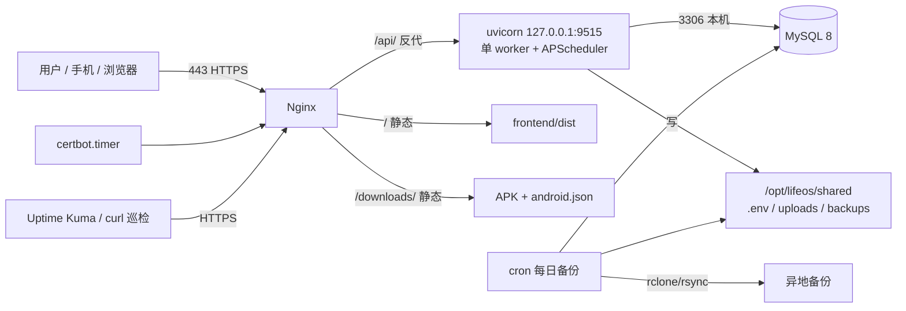

# 服务器部署方案研究

> 状态：研究 / 方案，不含代码改动，不安装依赖，不接触服务器。
> 基准：`master`（2026-11-08），后端 `backend/`，前端 `frontend/`，移动端 `mobile/`。
> 目标：给出一套能落地的单机部署，并区分「能跑起来的最小方案」与「长期稳定方案」。

---

## 0. 结论先行

| 项 | 结论 |
|---|---|
| 最小可行方案 | **1 台 2C4G Linux + Nginx + systemd（uvicorn 单 worker）+ 本机 MySQL 8 + certbot + cron 备份 + 静态 `dist` + `/downloads/` APK 目录**。 |
| 长期稳定方案 | 在最小方案上补：容器化/ IaC、异地加密备份 + 恢复演练、监控告警、CI/CD + staging、外置调度进程、数据库 PITR、APK 对象存储/CDN。 |
| 硬约束 | **uvicorn 必须单 worker**（调度器在进程内）；**9515 / 3306 不得公网**；**时区必须是 Asia/Shanghai**；**备份必须含 `uploads/` 与 `.env`**。 |
| 首次工作量 | 最小方案 0.5–1 人日（域名/DNS 已就绪）；含加固与演练 1.5–2 人日。 |
| 长期方案额外投入 | 3–5 人日搭建，之后每月 1–2 小时维护 + 每季度恢复演练。 |
| 前置条件 | 服务器、域名（大陆服务器需 ICP 备案）、DNS、80/443 放行、备份目的地、告警邮箱/IM、APK 签名 keystore 及其备份（当前为 debug keystore）。 |

---

## 1. 现状核对（先读仓库，再谈部署）

| 项 | 现状 | 依据 |
|---|---|---|
| 后端 | FastAPI 0.135.1 + uvicorn 0.42 + SQLAlchemy 2.x + PyMySQL | [requirements.txt](../../backend/requirements.txt#L1-L13) |
| 启动方式 | `uvicorn app.main:app`；README 用 9515；`APP_HOST`/`APP_PORT` 可被 CLI 覆盖 | [main.py](../../backend/app/main.py#L1-L30)、[README.md](../../README.md#L373-L390) |
| 数据库 | MySQL 8，`DATABASE_URL=mysql+pymysql://...`，连接池 10+20 | [config.py](../../backend/app/core/config.py#L20-L40)、[database.py](../../backend/app/core/database.py) |
| 迁移 | Alembic，3 个版本；baseline 建 61 张表 | `backend/alembic/versions/` |
| 定时任务 | **进程内 APScheduler**：通知扫描、备份、月报、体重秤采集；随 lifespan 启停 | [main.py](../../backend/app/main.py#L121-L155) |
| 前端 | Vite 构建为纯静态 `dist/`；请求固定 `/api/v1` 相对路径 | [api.ts](../../frontend/src/lib/api.ts#L1)、[vite.config.ts](../../frontend/vite.config.ts) |
| 移动端 | 服务器地址可配置；默认局域网 HTTP；release APK 已产出 | [app_config.dart](../../mobile/lib/core/config/app_config.dart#L5-L9) |
| 环境变量 | 有 `.env.example`；**但没有 `CORS_ORIGINS` 条目** | [.env.example](../../backend/.env.example) |
| 部署资产 | 仓库里**没有** Dockerfile、docker-compose、Nginx 配置、systemd unit、CI 配置 | 仓库检索结果 |
| 静态文件 | 头像挂载在 `/api/v1/uploads/avatars`，落在 `backend/uploads/avatars`；备份落在 `backend/backups` | [main.py](../../backend/app/main.py#L192-L198)、[avatar_storage.py](../../backend/app/services/avatar_storage.py#L27-L37)、[backup_service.py](../../backend/app/services/backup_service.py#L20-L25) |
| 日志 | 只输出到 stdout（uvicorn/journald），无文件日志轮转 | [logging_config.py](../../backend/app/core/logging_config.py) |
| 真实 IP | 后端直接取 `X-Forwarded-For` **第一段**，无白名单校验 | [auth.py](../../backend/app/api/routes/auth.py#L60-L66) |
| 限流 | 登录失败限流是**进程内内存**，多 worker 不共享 | [auth.py](../../backend/app/api/routes/auth.py#L38-L57) |
| 健康检查 | `/api/v1/health` 返回 `status: ok/degraded`，**HTTP 始终 200** | [health_check.py](../../backend/app/api/routes/health_check.py#L73-L93) |

### 1.1 两个会直接影响目录设计的硬编码

1. **`NOTIFICATION_ENC_KEY` 为空时，后端会生成并写回 `backend/.env`**（见 [crypto.py](../../backend/app/services/notification/crypto.py)）。如果每次发布都换一个 release 目录，新目录里没有这个 `.env`，就会重新生成密钥，导致**旧的渠道凭据全部解不开**。
2. **备份目录与头像目录是相对 `backend/` 解析的**（[backup_service.py](../../backend/app/services/backup_service.py#L20-L25)、[avatar_storage.py](../../backend/app/services/avatar_storage.py#L27-L37)）。版本化发布目录如果不做软链或绝对路径，头像和备份会留在旧 release 里，切版本后「数据还在但文件不见了」。

→ 因此下面的目录结构里，`.env`、`uploads/`、`backups/` 必须放在 `shared/`，并对每个 release 做软链或使用绝对路径。

### 1.2 README 现有部署方案：可复用的骨架与缺口

[README.md](../../README.md#L290-L460) 已经给出一条方向正确的单机路径（Nginx + systemd + MySQL + certbot + cron），可以直接作为最小方案的骨架。但按本仓库代码核对，有几处缺口会在实际运行中暴露：

| 缺口 | 具体表现 | 本文对应处理 |
|---|---|---|
| Nginx 没有 `client_max_body_size` | 默认 1 MB，备份导入/Excel/头像上传 413 | §3.7 设为 100m |
| Nginx 没有代理超时 | 报表导出超过 60 秒会 504 | §3.7 设 180s |
| 备份命令只做 `mysqldump` | 恢复后头像 404、通知渠道密钥丢失 | §3.11 明确备份 `uploads` 与 `.env` |
| XFF 用 `$proxy_add_x_forwarded_for`（追加） | 后端取首段，客户端可自带伪造 XFF | §3.3 改为覆盖 `$remote_addr` |
| 账号建的是 `'lifeos'@'localhost'` | PyMySQL 走 TCP，可能匹配不上 | §3.5 改用 `'lifeos'@'127.0.0.1'` |
| systemd 用 `User=www-data`，目录在 `/opt/lifeos` | 默认属主是 root，写 `uploads/`、`backups/`、`.env` 会失败 | §3.2/§3.6 建 `lifeos` 用户并授权 |
| 没有发布目录与回滚 | 直接改工作区，出问题只能手工翻 git | §3.2/§4 用 releases + current 软链 |
| 没有健康监控与证书续期检查 | health 恒 200，degraded 没人发现；证书过期才发现 | §3.12 解析 JSON + 到期告警 |


---

## 2. 目标架构



- 单机单进程，所有外部入口只经过 Nginx；后端与数据库只监听回环地址。
- APK 与版本清单由 Nginx 直接托管，不经过 Python 进程，天然支持 Range、断点续传和低 CPU。
- 定时任务与应用同进程，因此**部署形态决定了只能单 worker**；长期方案再拆出去。

---

## 3. 最小可行部署（单机）

### 3.1 资源与前置

| 项 | 建议 | 判断依据 |
|---|---|---|
| 系统 | Ubuntu 22.04 / 24.04 LTS，x86_64 | 软件源、certbot、systemd 都最省事 |
| 规格 | 2 vCPU / 4 GB 内存 / 40 GB SSD 起 | 单用户足够；报告生成与备份是短时峰值 |
| 交换 | 2 GB swap（可选） | 防止备份/构建瞬时 OOM |
| 域名 | 一个固定子域，如 `lifeos.example.com` | 证书与下载地址需要稳定域名 |
| 大陆服务器 | 使用域名 + 80/443 时需 **ICP 备案** | 未备案会被云厂商拦截 80/443；纯 IP 的证书支持有限、移动端信任也麻烦，建议用域名 |
| DNS | A/AAAA 指向服务器 | `dig +short lifeos.example.com` 应返回服务器 IP |
| 出站 | 443（certbot、通知渠道、apt）、SMTP 587/465（如启用邮件） | 安全组/ufw 出站默认放行即可 |

### 3.2 目录结构

```text
/opt/lifeos/
├── current -> /opt/lifeos/releases/2026-11-08T1200
├── releases/
│   └── 2026-11-08T1200/
│       ├── backend/                 # 后端代码（git archive 导出）
│       └── frontend/dist/           # 前端构建产物
├── venvs/
│   ├── current -> /opt/lifeos/venvs/2026-11-08T1200
│   └── 2026-11-08T1200/             # 每个 release 独立 venv
├── shared/
│   ├── .env                         # 唯一一份环境变量，chmod 600
│   ├── uploads/avatars/             # 头像（DB 只存相对 URL）
│   ├── backups/                     # 应用内备份 + OS 备份
│   └── downloads/                   # APK 下载目录
│       ├── android.json             # 版本清单
│       └── LifeOS-1.0.1-universal.apk
└── logs/                            # 如后续改为文件日志
```

每个 release 创建时执行：

```bash
# 服务账号与目录属主（Nginx 仍以 www-data 运行，需要目录可遍历）
useradd --system --home /opt/lifeos --shell /usr/sbin/nologin lifeos || true
chown -R lifeos:lifeos /opt/lifeos/shared
chmod 600 /opt/lifeos/shared/.env

ln -sfn /opt/lifeos/shared/.env        /opt/lifeos/releases/$REL/backend/.env
ln -sfn /opt/lifeos/shared/backups     /opt/lifeos/releases/$REL/backend/backups
```

> `.env` 必须属主为服务用户且 `600`；否则 systemd 以 `lifeos` 启动时读不到，或反过来被其他用户读到。`/opt/lifeos` 及 `releases`、`frontend/dist` 需对 `www-data` 保持可遍历（目录 `755`），否则 Nginx 返回 403。

并在 `.env` 中设置绝对路径：

```dotenv
AVATAR_UPLOAD_DIR=/opt/lifeos/shared/uploads/avatars
```

> 为什么不用「把整个 backend 目录挂成数据目录」：代码与数据混在一起会让回滚把数据一起回滚。软链是最小改动、风险最低的做法。长期方案再把这个硬编码改成可配置项。

### 3.3 环境变量与前缀

`.env` 放在 `shared/`，由 `current/backend/.env` 软链读取；systemd 只额外注入 `TZ`，避免 systemd `EnvironmentFile` 与 pydantic `.env` 的引号/转义规则不一致。

| 变量 | 生产建议 | 说明 / 依据 |
|---|---|---|
| `ENVIRONMENT` | `production` | 生产会拒绝默认 JWT 密钥，服务直接起不来 |
| `JWT_SECRET_KEY` | 64 位随机 hex | 泄露等于全站会话可伪造 |
| `DATABASE_URL` | `mysql+pymysql://lifeos:<密码>@127.0.0.1:3306/lifeos?charset=utf8mb4` | 密码含 `@ : / ? #` 时必须 URL 编码 |
| `CORS_ALLOW_ALL` | `false` | 同源部署不需要 CORS；默认 `true` 太宽 |
| `CORS_ORIGINS` | 仅跨域时才配，如 `["https://lifeos.example.com"]` | **`.env.example` 里没有这个键，需要手动加** |
| `NOTIFICATION_ENC_KEY` | 预生成 Fernet key，写入 `.env` 并异地备份 | 为空会自动生成并写 `backend/.env`；切 release 会丢 |
| `AVATAR_UPLOAD_DIR` | `/opt/lifeos/shared/uploads/avatars` | 绝对路径，避免切 release 后头像消失 |
| `MYSQLDUMP_PATH` | `/usr/bin/mysqldump` | 找不到会退化为 Python 导出，慢但可用 |
| `NOTIFY_SCAN_TIME` | 按实际需要，如 `00:00` | 依赖服务器时区 |
| `MONTHLY_REPORT_TIME` | 如 `07:00` | 同上 |
| `ENABLE_SCALE_COLLECTOR` | `false` | 服务器没有蓝牙；开着会反复重试 |
| `API_V1_PREFIX` | `/api/v1`，**不要改** | 前端硬编码 `/api/v1`，改前缀要同时改前端与移动端 |
| `PUBLIC_BASE_URL` | `https://lifeos.example.com` | 实现「检查更新」后新增：清单里的 `download_url` 用它拼，不信任请求 Host |
| `APP_RELEASE_DIR` | `/opt/lifeos/shared/downloads` | 实现「检查更新」后新增：后端读取 `android.json` 的目录 |
| `APP_HOST` / `APP_PORT` | 不用配，交给 systemd 的 CLI 参数 | CLI 覆盖环境变量 |
| `TZ` | `Asia/Shanghai` | 由 systemd `Environment=TZ=Asia/Shanghai` 注入 |

**反代路径规则**

- Nginx 用 `location /api/ { proxy_pass http://127.0.0.1:9515; }`，**`proxy_pass` 末尾不能加 `/`**。加了会把 `/api/v1/...` 改写成 `/v1/...`，后端全部 404。
- 不建议部署在子路径（如 `/lifeos/`）：前端路由、Vite `base`、`/api/v1` 绝对路径、移动端 baseUrl 都要改，收益低、坑多。用独立子域最稳。

**真实客户端 IP**

- 后端取 `X-Forwarded-For` 第一段（[auth.py](../../backend/app/api/routes/auth.py#L60-L66)），且没有可信代理白名单。
- Nginx 在边缘**覆盖**而不是追加：`proxy_set_header X-Forwarded-For $remote_addr;`。README 示例用的是 `$proxy_add_x_forwarded_for`（把客户端自带的 XFF 拼在最前），配合后端取首段，客户端可以伪造登录审计 IP；本文的配置改为覆盖。
- 如果前面还有 CDN/云 WAF：必须启用 `ngx_http_realip_module`，配置 `set_real_ip_from <可信段>` + `real_ip_header X-Forwarded-For`，否则第一段可能是客户端伪造的。配置后用登录审计里的 IP 做一次验证。
- 后端 9515 绝对不能公网可达，否则绕过 Nginx 直接伪造 XFF。

### 3.4 端口与防火墙

| 端口 | 监听 | 暴露 | 用途 |
|---|---|---|---|
| 22 | 0.0.0.0 | 公网（建议限制来源 IP） | SSH |
| 80 | 0.0.0.0 | 公网 | HTTP → HTTPS 跳转、certbot 验证 |
| 443 | 0.0.0.0 | 公网 | Nginx TLS |
| 9515 | **127.0.0.1** | 否 | uvicorn |
| 3306 | **127.0.0.1** | 否 | MySQL |

```bash
ufw default deny incoming
ufw default allow outgoing
ufw allow OpenSSH
ufw allow 80/tcp
ufw allow 443/tcp
ufw enable
ss -lntp | grep -E ':(22|80|443|9515|3306)'
```

云厂商安全组要单独配置（ufw 管不到云安全组）。判断依据：从外网 `nc -vz <IP> 9515` 必须超时；`ss` 输出里 9515/3306 必须是 `127.0.0.1`。

### 3.5 数据库

```sql
CREATE DATABASE lifeos CHARACTER SET utf8mb4 COLLATE utf8mb4_unicode_ci;
CREATE USER 'lifeos'@'127.0.0.1' IDENTIFIED BY '<强密码>';
GRANT ALL PRIVILEGES ON lifeos.* TO 'lifeos'@'127.0.0.1';
FLUSH PRIVILEGES;
```

`/etc/mysql/mysql.conf.d/mysqld.cnf`：

```ini
bind-address = 127.0.0.1
default-time-zone = '+08:00'
character-set-server = utf8mb4
collation-server = utf8mb4_unicode_ci
```

- 账号主机写 `127.0.0.1`，不要只写 `localhost`：PyMySQL 走 TCP，开启 `skip-name-resolve` 时 `localhost` 账号匹配不上。
- 验证：`mysql -h127.0.0.1 -ulifeos -p lifeos -e "SELECT NOW(), @@character_set_server;"`。
- 4 GB 内存可给 `innodb_buffer_pool_size=1G`；不要给到 3G，否则备份/构建时容易 OOM。

### 3.6 后端进程守护（systemd）

```ini
# /etc/systemd/system/lifeos.service
[Unit]
Description=LifeOS Backend
After=network-online.target mysql.service
Wants=network-online.target

[Service]
Type=simple
User=lifeos
Group=lifeos
WorkingDirectory=/opt/lifeos/current/backend
Environment=TZ=Asia/Shanghai
Environment=PYTHONUNBUFFERED=1
ExecStart=/opt/lifeos/venvs/current/bin/uvicorn app.main:app \
  --host 127.0.0.1 --port 9515 --workers 1 \
  --proxy-headers --forwarded-allow-ips=127.0.0.1
Restart=on-failure
RestartSec=5
TimeoutStopSec=30
NoNewPrivileges=true
PrivateTmp=true
ProtectHome=true
ReadWritePaths=/opt/lifeos/shared /opt/lifeos/current/backend
```

```bash
systemctl daemon-reload
systemctl enable --now lifeos
systemctl status lifeos --no-pager
journalctl -u lifeos -n 100 --no-pager
```

- **`--workers 1` 是硬约束**：调度器在 lifespan 内启动，多 worker 会重复发通知、重复生成月报、重复采集。判断依据：`ps -ef | grep uvicorn` 只能看到一个 worker；日志里调度器启动只出现一次。
- 不要把 `--reload` 带到生产：会常驻 Watcher、频繁重启、CPU 飙高。
- `ReadWritePaths` 要包含 `shared` 和当前 backend（`.env` 软链、`backups` 软链）；否则 systemd 沙箱下写备份会失败。
- 如后续要多 worker，必须把 APScheduler 拆到独立 systemd 服务/进程，或加分布式锁，再改 worker 数。

### 3.7 Nginx 反向代理 + HTTPS

```nginx
# /etc/nginx/conf.d/lifeos.conf
server {
    listen 80;
    server_name lifeos.example.com;
    return 301 https://$host$request_uri;
}

server {
    listen 443 ssl http2;
    server_name lifeos.example.com;

    ssl_certificate     /etc/letsencrypt/live/lifeos.example.com/fullchain.pem;
    ssl_certificate_key /etc/letsencrypt/live/lifeos.example.com/privkey.pem;
    ssl_protocols TLSv1.2 TLSv1.3;

    server_tokens off;
    client_max_body_size 100m;

    root /opt/lifeos/current/frontend/dist;
    index index.html;

    # Vite 产物带 hash，可长缓存
    location /assets/ {
        try_files $uri =404;
        expires 1y;
        add_header Cache-Control "public, immutable";
    }

    # 入口不缓存，避免发版后仍加载旧 index
    location = /index.html {
        add_header Cache-Control "no-cache, no-store, must-revalidate";
    }

    # SPA 路由回退
    location / {
        try_files $uri $uri/ /index.html;
    }

    # 后端：注意 proxy_pass 末尾没有 /
    location /api/ {
        proxy_pass http://127.0.0.1:9515;
        proxy_http_version 1.1;
        proxy_set_header Host $host;
        proxy_set_header X-Real-IP $remote_addr;
        proxy_set_header X-Forwarded-For $remote_addr;
        proxy_set_header X-Forwarded-Proto $scheme;
        proxy_set_header Connection "";
        proxy_read_timeout 180s;
        proxy_send_timeout 180s;
        proxy_max_temp_file_size 0;
    }

    # APK 与版本清单：root 指向 shared，URL /downloads/x -> shared/downloads/x
    location /downloads/ {
        root /opt/lifeos/shared;
        autoindex off;
        gzip off;
        types {
            application/vnd.android.package-archive apk;
            application/json json;
        }
        default_type application/octet-stream;
        add_header Cache-Control "public, max-age=300";
    }

    add_header X-Content-Type-Options nosniff always;
    add_header Referrer-Policy strict-origin-when-cross-origin always;
    # 确认全站 HTTPS 正常后再开 HSTS
    # add_header Strict-Transport-Security "max-age=31536000" always;
}
```

```bash
nginx -t && systemctl reload nginx
```

要点：

- `client_max_body_size 100m`：Nginx 默认 1 MB，备份导入、Excel 导入、头像上传都会 413。判断依据：上传一个 >1 MB 的备份 JSON，不能出现 413。
- `proxy_read_timeout 180s`：月报/PDF/大备份导出可能超过默认 60 秒；判断依据：导出一次 90 天报告不出现 504。
- `/downloads/` 用 `root` 而不是 `alias`，避免 alias 路径拼接错误；`gzip off` 对已压缩的 APK 没意义且浪费 CPU。
- `Accept-Ranges` 与 `206` 由 Nginx 静态模块自动处理；判断依据：`curl -r 0-1023 -o /tmp/part -D - https://.../x.apk` 必须返回 `206`。
- 反向代理下路径前缀不要改；`/api/v1` 原样透传。

### 3.8 证书申请与续期

**首次部署的顺序很重要**：上面的 443 配置引用了还不存在的证书文件，直接 `nginx -t` 会失败。正确顺序是：

1. 先只写 80 端口的 server 块（保留 `location /api/`、`/downloads/`、静态 `root`；**先不要写 301 跳转**，确保 ACME 验证可达），`nginx -t && systemctl reload nginx`；
2. `certbot --nginx -d lifeos.example.com`，由 certbot 申请证书并改写配置（或 `certbot certonly --nginx` 后手工补 443 server 块）；
3. 再启用完整的 443 配置，`nginx -t && systemctl reload nginx`；
4. 最后验证证书与跳转。

```bash
apt install -y certbot python3-certbot-nginx
certbot --nginx -d lifeos.example.com
systemctl list-timers | grep certbot
certbot renew --dry-run
```

- certbot 会安装 `certbot.timer`，默认每日两次检查、到期前 30 天续期。
- 续期后需要 reload Nginx；certbot 的 nginx 插件通常会自动处理，但要确认 `--deploy-hook "systemctl reload nginx"` 已生效。
- 判断依据：`openssl s_client -connect lifeos.example.com:443 -servername lifeos.example.com </dev/null 2>/dev/null | openssl x509 -noout -dates` 剩余天数 > 30；`certbot renew --dry-run` 成功。
- 80 端口被封会导致 HTTP-01 验证失败；云安全组与 ufw 都要放行。若使用 DNS-01，则可避开 80，但配置更复杂。
- HSTS 最后再开：确认所有子路径、移动端下载、API 都走 HTTPS 后再加，否则回退困难。

### 3.9 前端静态发布与原子切换

```bash
# 构建机（或 CI）
cd frontend
npm ci
npm run build          # 产物 frontend/dist

# 上传到新 release
rsync -a frontend/dist/ root@server:/opt/lifeos/releases/$REL/frontend/dist/
```

切换：

```bash
ln -sfn /opt/lifeos/releases/$REL /opt/lifeos/current
systemctl restart lifeos      # 整目录切换会同时换后端代码，必须重启
nginx -s reload               # 让 Nginx 重新解析 root 软链
```

- `index.html` 必须 no-cache，`assets/*` 才能 immutable；判断依据：发版后强刷一次，响应头里 `index.html` 是 `no-cache`，`assets/xxx.js` 是长缓存。
- **不要在服务器上设置 `VITE_DEMO=1`**。前端有演示模式（README 的 Vercel 演示站点用到），生产误开会导致页面走 mock 数据、完全不请求后端。判断依据：生产页面登录后能看到真实数据，Network 里有 `/api/v1` 请求。
- 服务器不需要 Node；构建在本地/CI 完成，减少攻击面。

### 3.10 APK 下载页与版本清单

- 目录：`/opt/lifeos/shared/downloads/`，由 Nginx `/downloads/` 暴露。
- 文件命名建议：`LifeOS-<versionName>-universal.apk`；清单 `android.json`。
- 当前通用包 63.2 MB（2026-11-15 实测：63,239,430 字节，三 ABI 合并）；下载页要显示体积并提示「建议 Wi-Fi」，别按旧文档的 22 MB 去估带宽和超时。
- 发布步骤：
  1. `flutter build apk --release --build-number <递增>`；
  2. `aapt dump badging` 确认 `versionCode` / `versionName`；
  3. `apksigner verify --print-certs` 记录证书指纹，与清单里的 `signing_cert_sha256` 比对（当前签名就是 `CN=Android Debug`，这本身不是错误；比对是为了发现签名漂移，漂移意味着老用户装不上）；
  4. `sha256sum` 写入清单；
  5. 先上传 APK，再原子替换清单（`mv android.json.tmp android.json`）；
  6. `curl` 校验清单与 APK 的 `Content-Type`、`Content-Length`、`206`。
- 简单下载页可以是静态 `index.html`（列出最新版本、更新说明、直链、二维码），也可以只给直链；不要依赖 GitHub Releases 作为唯一入口。
- 微信/QQ 内置浏览器可能拦截 APK 下载，页面上要写「请用系统浏览器打开」。
- 版本清单字段与强制更新策略见 [01_检查更新方案.md](./01_检查更新方案.md)。

### 3.11 备份与迁移

**备份对象（缺一不可）**

| 对象 | 方式 | 说明 |
|---|---|---|
| MySQL | `mysqldump --single-transaction --quick --routines --triggers --default-character-set=utf8mb4` + gzip | 逻辑备份，恢复简单 |
| 头像 | `tar` 打包 `shared/uploads/avatars` | **DB 只存 URL，不备份文件会导致头像 404** |
| `.env` | 加密后单独备份 | 含 JWT 与 Fernet 密钥；丢失后通知渠道凭据无法解密 |
| 版本清单/APK | 可选 | 至少保留最近 3 个 APK |

```bash
umask 077
mysqldump --single-transaction --quick --routines --triggers \
  --default-character-set=utf8mb4 \
  -h127.0.0.1 -ulifeos -p"$DB_PASS" lifeos \
  | gzip > /opt/lifeos/shared/backups/db-$(date +%F).sql.gz
tar -czf /opt/lifeos/shared/backups/files-$(date +%F).tar.gz \
  -C /opt/lifeos/shared uploads .env
gzip -t /opt/lifeos/shared/backups/db-$(date +%F).sql.gz
```

- 保留策略：日备 14 天、周备 8 周、月备 6 个月；清理只针对 `db-YYYY-MM-DD` 日备，周/月备用不同前缀单独保留，避免 `find -mtime +14 -delete` 把月度备份一起删掉。
- 异地：`rclone sync` 到加密远端，或 `restic`/`borg` 加密仓库；不要只留同一块盘。
- 恢复演练（每季度）：把 dump 导入临时库 `lifeos_restore`，比对关键表行数；解包 files，抽查头像文件数与 DB 中 `/api/v1/uploads/avatars/...` 记录数是否一致。
- 应用内也有备份调度器（写 `backend/backups`，已软链到 `shared/backups`），它只覆盖数据库内容；**OS 级 dump 才是灾难恢复的权威版本**，两者不要混为一谈。

**迁移顺序**

```bash
cd /opt/lifeos/current/backend
/opt/lifeos/venvs/current/bin/alembic current
/opt/lifeos/venvs/current/bin/alembic history
/opt/lifeos/venvs/current/bin/alembic upgrade head
```

- baseline 的 `downgrade()` 会**按逆序删除全部 61 张表**（[baseline 迁移](../../backend/alembic/versions/943429348ec7_baseline_现有_61_张表与_11_条复合索引.py) 末尾）。生产环境**禁止**用 `alembic downgrade` 做日常回滚。
- 迁移前必须停旧后端、做 dump；迁移脚本失败时直接恢复 dump，不要在半迁移状态上继续启动。
- 长期方案应在 staging 库上先跑一遍迁移与恢复演练。

### 3.12 日志与基础监控

| 项 | 最小做法 | 判断依据 |
|---|---|---|
| 应用日志 | `journalctl -u lifeos -f`；`/etc/systemd/journald.conf` 设 `SystemMaxUse=1G` | 日志可查、磁盘不被写满 |
| Nginx 日志 | 默认 `access.log` / `error.log`，logrotate 已自带 | 能看到 4xx/5xx 与下载请求 |
| 存活 | cron 每 5 分钟 `curl -fsS https://domain/api/v1/health` | HTTP 200 **不代表健康**；必须解析 JSON 的 `status` |
| 依赖 | health 里 `database` / `schedulers` 字段 | `status != ok` 或 scheduler 非 running 就告警 |
| 磁盘 | `df -h` 阈值 80% 告警 | 备份 + APK + 日志会持续增长 |
| 证书 | `openssl x509 -enddate` 剩余 < 21 天告警 | 避免续期失败后静默过期 |
| 外部拨测 | Uptime Kuma（可选，Docker 或独立小机器） | 从外部验证域名/证书/端口 |
| 告警通道 | 邮件或飞书/Telegram webhook | 确保不是「只写日志没人看」 |

> 注意：`/api/v1/health` 在数据库或调度器异常时仍返回 HTTP 200，只是 JSON 里 `status=degraded`。只用 `curl -f` 的监控会漏报。判断依据：停掉 MySQL 后 `curl -s ... | jq -r .status` 应为 `degraded`。

---

## 4. 上线顺序与回滚

### 4.1 上线顺序（先库、后服务、再前端）

| 步骤 | 操作 | 失败时 |
|---|---|---|
| 0 | 预检：磁盘、`systemctl status`、health、`alembic current` | 停止，不发布 |
| 1 | 备份：DB dump + `uploads` + `.env` + 旧 `android.json` | 备份失败禁止继续 |
| 2 | 上传新 release（代码 + 前端 dist + venv） | 旧 release 不动 |
| 3 | **停旧后端**（维护窗口） | 重启旧服务即可 |
| 4 | **库**：`alembic upgrade head` | 迁移失败 → 恢复 dump，回旧代码 |
| 5 | **服务**：启动新后端，验证 health / 登录 / 关键接口 | 回退 `current` + 恢复 dump（如已迁移） |
| 6 | **前端**：`ln -sfn` 切 `current`，`nginx -s reload` | 切回上一个 release 软链 |
| 7 | APK：上传新包 → 原子替换清单 | 恢复旧清单文件 |
| 8 | 冒烟：登录、账单、报表导出、头像上传、移动端检查更新 | 按回滚表处理 |
| 9 | 观察 24 小时：错误日志、health、下载量、调度任务 | 异常则回滚 |

> 为什么「先库后服务再前端」：新前端可能调用新接口，必须先有新后端；旧前端通常能兼容新后端（新增字段/接口），所以前端最后切换。若迁移是破坏性的（删列/改语义），必须先停旧后端再迁移，避免旧代码在迁移后继续写坏数据。

### 4.2 回滚办法

| 层 | 操作 | 限制 |
|---|---|---|
| 前端 | `ln -sfn /opt/lifeos/releases/<上一个> /opt/lifeos/current` + `nginx -s reload` | 秒级；需 Nginx 重新解析软链 |
| 后端 | 切回上一个 `current`，`systemctl restart lifeos`；venv 同步切回 | 若 DB 已迁移到不兼容结构，旧代码可能报错 |
| 数据库 | 停服务 → 恢复发布前 dump → 启动旧代码 | **唯一可靠**的破坏性迁移回滚；会丢发布后的新数据 |
| Alembic | `alembic downgrade -1`（仅当该迁移有真实、测试过的 downgrade） | baseline 会删全部表，禁止生产使用 |
| APK | 无法通过安装降级（Android 拒绝低 `versionCode`） | 保留旧包下载；实在要退只能卸载重装（丢本地登录态，服务端数据不丢） |
| 清单 | `mv android.json.bak android.json` | 立即生效；客户端下次检查才感知 |

回滚演练要求：至少演练过一次「前端软链切回」和一次「dump 恢复到临时库」；不要等到真出事才第一次执行。

---

## 5. 长期稳定方案（额外投入）

| 能力 | 最小方案 | 长期稳定方案 | 额外投入 |
|---|---|---|---|
| 部署 | 手工 rsync + systemd | Docker Compose 或 Ansible/Terraform；镜像按 digest 固定 | 1–2 人日；需要 CI 与镜像仓库 |
| 发布 | 手工切软链 | CI/CD：构建 → 测试 → 部署；staging 先验证 | 1–2 人日 + 维护流水线 |
| 进程模型 | 单 uvicorn worker + 进程内调度 | 外置调度进程（独立 systemd/容器）+ Web 多 worker/多实例 | 0.5–1 人日；需改调度启动方式与锁 |
| 数据库 | 同机 MySQL + 逻辑备份 | 托管 MySQL 或主从 + binlog/PITR；连接池按实例数调整 | 1 人日 + 月费 |
| 备份 | 本地每日 dump | 异地加密（restic/borg/rclone）+ 定期恢复演练 + 保留策略 | 0.5–1 人日 + 存储费 |
| 监控 | cron curl + 邮件 | Uptime Kuma / Prometheus + Grafana / Loki；证书、磁盘、调度、错误率告警 | 1 人日 + 监控主机 |
| 安全 | ufw + 强密码 | fail2ban、SSH 仅密钥、unattended-upgrades、最小权限、WAF/限流 | 0.5–1 人日 |
| APK 分发 | 本机 Nginx | 对象存储 + CDN + 签名清单；多地域 | 0.5 人日 + 流量费 |
| 容灾 | 单机 | 快照 + 跨可用区/跨地域；RTO/RPO 目标与演练 | 1–2 人日 |

**长期方案建议的 Compose 拓扑（可选）**

```text
nginx (80/443)  ->  backend (1 实例，uvicorn 单 worker)
                 ->  frontend 静态（可并进 nginx 镜像）
mysql (volume)  <- backend
certbot (定时)  -> 共享 letsencrypt volume
backup (cron 容器) -> mysql + uploads volume -> 异地
uptime-kuma / node-exporter（可选）
```

- Compose 也要保证 backend 只有 1 个副本（调度器）；要扩容 Web 时必须先拆调度器。
- MySQL 数据、`uploads`、`backups`、`.env` 全部用 volume/只读挂载，升级镜像不碰数据。
- 镜像不要用 `latest`，固定 tag/digest；升级前 `docker compose config` 校验。
- 容器内同样要设 `TZ=Asia/Shanghai`，否则定时任务偏移。

---

## 6. 上线前必须确认的清单

| # | 检查项 | 判断依据（必须可观测） |
|---|---|---|
| 1 | 域名解析 | `dig +short lifeos.example.com` 返回服务器 IP |
| 2 | 证书有效 | `openssl s_client ...` 的 `notAfter` 剩余 > 30 天 |
| 3 | HTTPS 可访问 | `curl -I https://lifeos.example.com/` 返回 200 |
| 4 | HTTP 跳转 | `curl -I http://lifeos.example.com/` 返回 301 到 https |
| 5 | 后端存活 | `systemctl is-active lifeos` 为 `active`；`journalctl` 10 分钟内无 ERROR |
| 6 | 健康状态 | `curl -s .../api/v1/health \| jq -r .status` 为 `ok`（不是只看 HTTP 200） |
| 7 | 数据库迁移 | `alembic current` 与 `alembic heads` 一致 |
| 8 | 时区 | `timedatectl` 显示 `Asia/Shanghai`；`mysql -e "SELECT NOW()"` 与 `date` 相差 < 1 分钟 |
| 9 | 调度器 | health 的 `schedulers` 全部 running；手动触发一次扫描/备份有日志 |
| 10 | 真实 IP | 登录一次，`login_audits` 里记录的是公网客户端 IP，不是 127.0.0.1 |
| 11 | 大文件上传 | 上传 >1 MB 备份/Excel/头像不出现 413 |
| 12 | 报表导出 | 导出 90 天报告不出现 504；耗时在 `proxy_read_timeout` 内 |
| 13 | SPA 深链 | 直接打开 `/finance/bills` 返回页面而不是 404 |
| 14 | 静态缓存 | `index.html` 响应头 `no-cache`；`assets/*` 长缓存 |
| 15 | 前端未走 mock | 生产 Network 有 `/api/v1` 请求；`VITE_DEMO` 未设置 |
| 16 | 端口收敛 | 外网 `nc -vz IP 9515`、`3306` 均超时；`ss` 显示仅 127.0.0.1 |
| 17 | CORS | `CORS_ALLOW_ALL=false`；用恶意 Origin 预检不返回 `*` |
| 18 | 数据目录 | `shared/uploads`、`shared/backups` 可写；切 release 后头像仍可访问 |
| 19 | 备份可用 | dump 非空、`gzip -t` 通过；临时库恢复后关键表行数与生产一致 |
| 20 | 异地备份 | 远端能看到当天文件；至少完成一次下载/校验 |
| 21 | 磁盘 | `df -h` 剩余 > 20%；备份目录大小有上限策略 |
| 22 | 证书续期 | `certbot renew --dry-run` 成功；`certbot.timer` 存在 |
| 23 | 日志轮转 | journald 有 `SystemMaxUse`；Nginx logrotate 正常 |
| 24 | APK | `apksigner` 证书指纹与清单一致（当前即 `CN=Android Debug`，指纹 `ebbe0aaa…39b6`）；`aapt` 的 `versionCode` 比线上旧包大 |
| 25 | 下载链路 | `curl -r 0-1023` 返回 206；`Content-Type` 为 `application/vnd.android.package-archive` |
| 26 | 移动端 | 真机安装 → 登录 → 检查更新 → 下载 → 覆盖安装，数据不丢 |
| 27 | 回滚 | 已在预发/低峰演练过前端软链切回与 dump 恢复 |
| 28 | 安全 | SSH 仅密钥、root 禁登录、ufw 生效、系统补丁已更新 |

---

## 7. 最容易踩的坑

| # | 坑 | 根因 / 触发条件 | 判断依据 | 处理 |
|---|---|---|---|---|
| 1 | 通知/月报重复发送 | `uvicorn --workers N`，每个 worker 都启动 APScheduler | `ps -ef \| grep uvicorn` 看到多个 worker；同一条通知出现 N 次 | 固定 `--workers 1`；要多 worker 先拆调度器 |
| 2 | 服务启动直接失败 | `ENVIRONMENT=production` 且 JWT 仍是默认值 | `journalctl` 出现「生产环境必须配置 JWT_SECRET_KEY」 | 预生成强密钥写入 `shared/.env` |
| 3 | 切 release 后渠道凭据解不开 | `.env` 在新 release 中不存在，`NOTIFICATION_ENC_KEY` 被重新生成 | 新 release 的 `backend/.env` 是新建文件；旧通知渠道报解密失败 | `shared/.env` 软链；密钥异地备份；启动前确认变量已存在 |
| 4 | 切 release 后头像 404 / 备份消失 | `uploads`、`backups` 相对 `backend/` 解析 | 新 release 下出现空的 `uploads/avatars`、`backups/` | `AVATAR_UPLOAD_DIR` 用绝对路径；`backups` 软链 shared |
| 5 | 上传/导入 413 | Nginx 默认 `client_max_body_size 1m` | `curl -F file=@large` 返回 413 | server 级设 `100m`，并验证 >1 MB 文件 |
| 6 | API 全部 404 | `proxy_pass http://127.0.0.1:9515/` 带了尾斜杠，路径被截断 | 访问 `/api/v1/health` 返回 404；Nginx 日志路径变成 `/v1/health` | `proxy_pass` 末尾不加 `/` |
| 7 | 登录审计 IP 全是 127.0.0.1 / 可伪造 | Nginx 没覆盖 XFF，或后端 9515 公网可达 | `login_audits` 里是内网地址；外部直接请求 9515 成功 | 覆盖 `X-Forwarded-For $remote_addr`；9515 只监听回环 |
| 8 | 定时任务偏 8 小时 | 服务器/systemd/MySQL 时区是 UTC | `timedatectl` 不是 Asia/Shanghai；`SELECT NOW()` 与本地时间差 8 小时 | 系统时区 + systemd `TZ` + MySQL `default-time-zone` 三处统一 |
| 9 | 备份「成功」但恢复后缺文件 | 只 dump 了数据库，没备份 `uploads` 和 `.env` | 恢复后头像 URL 404；渠道凭据解密失败 | 备份清单强制包含 files 与 `.env`；季度演练 |
| 10 | MySQL 连接被拒 | 账号只建了 `'lifeos'@'localhost'`，PyMySQL 走 TCP 127.0.0.1 | `mysql -h127.0.0.1 -ulifeos` 报 Access denied | 建 `'lifeos'@'127.0.0.1'` 并实测 |
| 11 | CORS 过宽 | 默认 `CORS_ALLOW_ALL=true`，生产没改 | 任意 Origin 预检都返回 `*` | 生产设 false；同源部署无需 CORS |
| 12 | 生产页面全是假数据 | 构建时误设 `VITE_DEMO=1` | Network 没有 `/api/v1` 请求；页面数据与演示站一致 | 构建脚本显式 `VITE_DEMO` 不设置；部署后抽查接口 |
| 13 | 发版后用户仍看到旧页面 | `index.html` 被缓存 | 响应头 `Cache-Control` 不是 no-cache；旧 hash 资源 404 | `index.html` no-cache；`assets` immutable |
| 14 | 刷新深链 404 | 缺少 SPA `try_files` 回退 | 直接访问 `/finance/bills` 返回 Nginx 404 | `try_files $uri $uri/ /index.html;` |
| 15 | 迁移「回滚」把库清空 | 执行 `alembic downgrade base` | baseline 的 downgrade 逆序 drop 全部 61 张表 | 禁止生产 downgrade；回滚用 dump 恢复 |
| 16 | 迁移后旧接口 500 | 没停旧后端就迁移，或旧代码与新表结构不兼容 | 迁移后日志出现 Unknown column / 类型错误 | 维护窗口：停服务 → 迁移 → 起新服务 |
| 17 | `mysqldump` 不存在，备份悄悄变慢 | 容器/精简系统没装客户端，代码退化为 Python 导出 | 备份日志提示找不到 mysqldump；大库备份超时 | 安装 `mysql-client`，配置 `MYSQLDUMP_PATH` |
| 18 | 导出报表 504 | `proxy_read_timeout` 默认 60s，报表生成超过 60s | Nginx error log 出现 upstream timed out | 调到 180s；实测 90 天导出 |
| 19 | APK 下载被识别成普通文件 | `/downloads/` 没配 APK MIME | `curl -I` 的 `Content-Type` 是 `application/octet-stream` | 显式 `types { application/vnd.android.package-archive apk; }` |
| 20 | 断点续传失效 | 反向代理/压缩/缓存层不支持 Range | `curl -r` 返回 200 而不是 206 | 静态直出、`gzip off`、确认 `Accept-Ranges` |
| 21 | 磁盘被备份写满 | 没有保留策略/异地只是同盘 | `df -h` 持续下降；备份目录无限增长 | 日/周/月保留 + 异地 + 磁盘 80% 告警 |
| 22 | 证书到期未续 | 80 端口被安全组拦住；timer 未运行 | `certbot renew --dry-run` 失败；证书剩余 < 30 天 | 放行 80/443；检查 timer；到期前告警 |
| 23 | 备份写入失败 | systemd 沙箱 `ProtectSystem`/权限不足 | `journalctl` 出现 Permission denied | `ReadWritePaths` 包含 shared；目录属主为服务用户 |
| 24 | 大文件导出占满 Nginx 临时盘 | `proxy_buffering` + 大响应/慢客户端 | Nginx 临时目录增长；磁盘告警 | 大响应走流式；`proxy_max_temp_file_size 0`；APK 走静态 |
| 25 | 数据库密码含特殊字符连不上 | `DATABASE_URL` 未 URL 编码 | 启动时报 URL 解析错误 / Access denied | 密码做 URL 编码，或用简单安全字符 |
| 26 | 多实例部署后限流失效 | 登录限流是进程内存，多 worker/多机不共享 | 暴力尝试在多个实例间绕过 | 单实例 + Nginx `limit_req`；长期用 Redis/集中限流 |
| 27 | 健康检查「假绿」 | `/health` 异常也返回 200 | HTTP 200 但 JSON `status=degraded` | 监控解析 JSON；依赖 `database`/`schedulers` 字段 |
| 28 | 子路径部署后前端全挂 | 前端 `/api/v1` 绝对路径 + Vite base 未改 | 请求打到域名根而不是 `/lifeos/` | 用独立子域；不要在子路径部署 |
| 29 | `ENABLE_SCALE_COLLECTOR=true` 导致反复报错 | 服务器无蓝牙，采集器持续重试 | 日志持续出现 BLE 扫描失败 | 生产设 `false` |
| 30 | APK 与清单不一致 | 先改清单后传包，或上传中断 | `sha256`/`size` 与文件不符；客户端下载后校验失败 | 先传包后原子替换清单；发布脚本强校验 |
| 31 | 首次上 HTTPS 时 Nginx 起不来 | 443 配置引用了尚未签发的证书文件 | `nginx -t` 报 `cannot load certificate` | 先用 80 配置启动，跑 certbot 拿到证书后再启用 443 |

---

## 8. 工作量与前置条件

### 8.1 工作量

| 阶段 | 内容 | 人日 |
|---|---|---|
| 最小方案 | 系统初始化、MySQL、systemd、Nginx、HTTPS、目录/软链、前端上传、冒烟 | 0.5–1（域名已就绪） |
| 最小方案加固 | ufw/SSH/时区/日志/定时备份/健康巡检/回滚演练 | 0.5–1 |
| APK 下载与清单 | `/downloads/`、清单、发布脚本、Range/MIME 验证 | 0.5 |
| 长期方案 | Compose/CI、staging、监控告警、异地备份、恢复演练、调度拆分 | 3–5 |
| 持续运维 | 补丁、证书、磁盘、备份校验、依赖升级 | 1–2 小时/月 |

### 8.2 前置条件

- [ ] 一台可 SSH 的 Linux 服务器，root/sudo 可用，系统时间已同步。
- [ ] 域名 + DNS A 记录；大陆服务器使用域名需 ICP 备案。
- [ ] 80/443 在云安全组与 ufw 均放行；22 建议限制来源。
- [ ] 备份目的地（另一台机器/对象存储/加密远端）与告警通道（邮箱/飞书/Telegram）。
- [ ] APK 签名 keystore 与其备份（当前为 debug keystore，备份在 `C:\Users\Administrator\OneDrive\LifeOS-backup\debug.keystore`）；密钥不入库。
- [ ] 明确维护窗口；迁移前可停机。
- [ ] 至少准备一份可恢复的 `dump` 与一次恢复演练记录。

---

## 9. 待验证项

1. **目标服务器实测**：Ubuntu 版本、MySQL 8 配置项、systemd 沙箱与 `ReadWritePaths` 的实际写权限；本文件给的是通用配置，需在目标机跑一遍。
2. **域名/备案状态**：是否已有域名、是否在大陆服务器、是否需要 ICP 备案；没有域名时不能直接套用 certbot 流程。
3. **`NOTIFICATION_ENC_KEY` 的初次生成行为**：首次部署前预生成并写入 `shared/.env`，再启动服务，确认不会在 release 目录里新建 `.env`。
4. **备份/头像目录软链**：按本文结构建好后，切一次 release，确认头像仍可访问、备份仍写入 `shared/backups`。
5. **备份体积与耗时**：实际库大小、头像总量未知；需要实测 dump 时间与磁盘占用，再定保留策略。
6. **是否上 Docker/CI**：取决于后续是否要自动化；最小方案不依赖 Docker，长期方案再引入。
7. **APK 下载链路**：需与 [01_检查更新方案.md](./01_检查更新方案.md) 的版本接口、清单里的签名指纹一致性一起验证。
